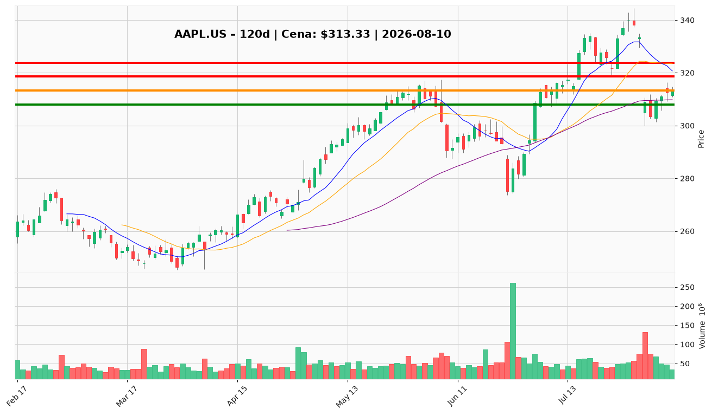

# AAPL.US — Ticket posiadacza (2026-08-10)

**Werdykt:** HOLD
**Horyzont:** swing (dni–tygodnie)
**Cena ref.:** $313.33

| | Poziom | Uwagi |
|---|--------|------|
| **Akcja teraz** | Trzymaj | Bez dokupu — czekaj na reclaim $318+ z wolumenem |
| **Stop-loss** | $308.00 | Twardy — poniżej 50 SMA i klastra wsparcia z 31.07 |
| **TP1** | $318.73 | Redukcja 50% pozycji (strefa 10 EMA / VWMA) |
| **TP2** | $323.72 | Wyjście z reszty (środek Bollingera / dawne wsparcie) |

**Pozycja zapisana:** wejście $331.24 | SL $308.00 | TP1 $318.73 | TP2 $323.72

**Sizing / skala:** Utrzymaj pełną pozycję. Nie dokupuj — pozycja jest -5,4% pod wodą i odbicie nie jest potwierdzone. Przy TP1 sprzedaj połowę, resztę przy TP2.

**Warunek dokupu:** Zamknięcie powyżej $318.00 przy wolumenie >50M — dopiero wtedy rozważ dokup.

**Unieważnienie / pełne wyjście:** Dzienne zamknięcie poniżej $308.00 — wyjdź z całości, otwiera drogę do $300.

**Dlaczego (1–2 zdania):** Apple broni 50-dniowej średniej po gwałtownym spadku post-earnings; fundamenty (FCF $32B/kwartał, buybacki $25B/kwartał) wspierają trzymanie, ale momentum krótkoterminowe jest słabe (MACD bearish, cena pod 10 EMA). Dla swing: trzymaj ze stop-loss, skaluj zyski w strefie $318–$324.

**WERDYKT KOŃCOWY:** HOLD — utrzymaj pozycję ze stop-loss $308, realizuj częściowo przy $318.73 i $323.72, bez dokupu do potwierdzenia odbicia.

