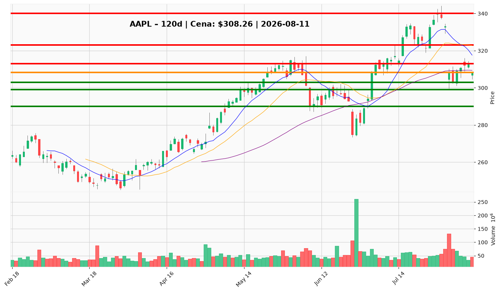

# AAPL.US — Ticket posiadacza (2026-08-11)

**Werdykt:** HOLD
**Horyzont:** swing (dni–tygodnie)
**Cena ref.:** $308.26

| | Poziom | Uwagi |
|---|--------|------|
| **Akcja teraz** | trzymaj | brak dokupu poniżej $313; redukcja dopiero przy wybiciu $299 |
| **Stop-loss** | $299.00 | twardy — poniżej dołka z 31.07 ($299.74) |
| **TP1** | $323.00 | redukcja części — środek Bollingera / podstawa sprzed krachu |
| **TP2** | $340.00 | wyjście reszty — retest okolic 52-tyg. szczytu $344 |

**Sizing / skala:** utrzymaj obecną pozycję bez zmian. Dokup (max ~1R) tylko po pewnym zamknięciu powyżej $313 na podwyższonym wolumenie. ATR ~$8.9 — unikaj ciasnych stopów.

**Warunek dokupu (jeśli ADD):** daily close > $313 + MACD histogram dodatni → dokup częściowy w strefie $313–315, SL całości $299, docelowo $323.

**Unieważnienie / pełne wyjście:** zamknięcie dzienne poniżej $299.00 — struktura wsparcia pęka, cel $290–291, potem strefa 200 SMA ($279–283). Pełny EXIT wtedy.

**Pozycja zapisana:** entry $331.24, dotychczasowy SL $308.0, TP1 $318.73, TP2 $323.72 (holdings). Obecny SL $299 (twardy) zastępuje go — ochrona przed dalszą przeceną po wybiciu wsparcia.

**Dlaczego (1–2 zdania):** Fundamenty wyjątkowe (+16% przychody, ~$108 mld FCF TTM, 50% marża) i trend długoterminowy nietknięty (200 SMA rośnie), ale struktura krótkoterminowa złamana (luka z 31.07, dwie odrzucone próby $313, ujemny MACD) i przed nami ryzyko katalizatora (iPhone 18 / koszty pamięci, downgrade Jefferies do $263.66). Trzymaj z twardym SL, działaj na $313 lub $299.

**WERDYKT KOŃCOWY:** HOLD — trzymaj pozycję ze stopem $299; bez dokupów poniżej $313, wyjście przy zamknięciu < $299.

