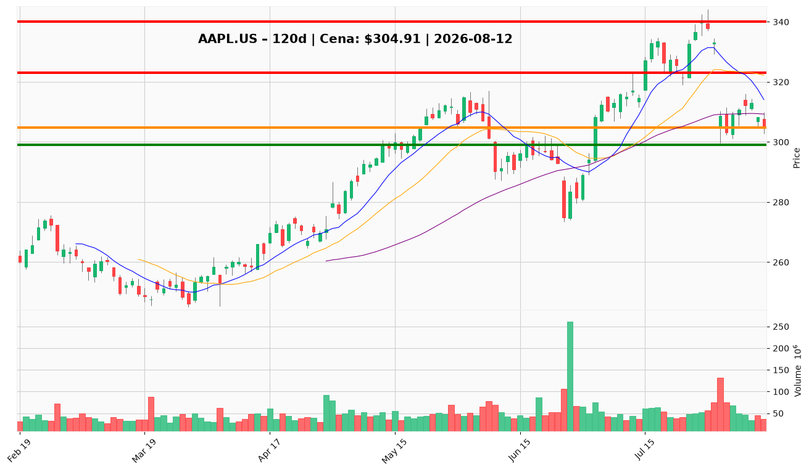

# AAPL.US — Ticket posiadacza (2026-08-12)

**Werdykt:** HOLD
**Horyzont:** swing (dni–tygodnie)
**Cena ref.:** $304.91

| | Poziom | Uwagi |
|---|--------|------|
| **Akcja teraz** | Trzymaj | Bez dokupu na rynku; pozycja zapisana entry $331.24 |
| **Stop-loss** | $299.00 | Twardy — poniżej dołka 31.07 i dolnej wstęgi Bollingera |
| **TP1** | $323.00 | Redukcja ~30–40% przy odzyskaniu 20 SMA / środka BB |
| **TP2** | $340.00 | Wyjście reszty przy strefie wcześniejszego oporu |

**Sizing / skala:** Utrzymaj pełną pozycję. Nie dokupuj przy $305 — momentum krótkoterminowe jest negatywne (MACD bearish, cena pod 50 SMA $309). Warunkowy dokup tylko przy odbiciu z $300–302 z RSI > 50 i podwyższonym wolumenem (max 1–2% portfela).

**Warunek dokupu** (jeśli ADD): Odbicie z $300–302 z potwierdzeniem wolumenu i RSI powyżej 50 — nie dotyczy obecnego werdyktu HOLD.

**Unieważnienie / pełne wyjście:** Dzienne zamknięcie poniżej $299.00 na podwyższonym wolumenie → redukcja do 50% lub pełne wyjście; następny poziom wsparcia 200 SMA ~$279.

**Dlaczego (1–2 zdania):** Apple pozostaje fundamentalnie silny (rekordowy Q2, marża 27,6%, FCF $107,7B), ale krótkoterminowy sentyment jest negatywny po downgrade Jefferies, obawach o cykl iPhone i słabszej reakcji po wynikach vs AMZN. Technicznie presja sprzedaży (MACD bearish, cena pod 50 SMA), lecz długoterminowa struktura powyżej 200 SMA ($279) jest zachowana. Przy entry $331.24 pozycja jest pod wodą — trzymaj z dyscypliną SL $299 i czekaj na TP1 $323.

**WERDYKT KOŃCOWY:** HOLD — utrzymaj pozycję, nie dokupuj na rynku, chroń kapitał SL $299, realizuj częściowo przy $323 i $340.

