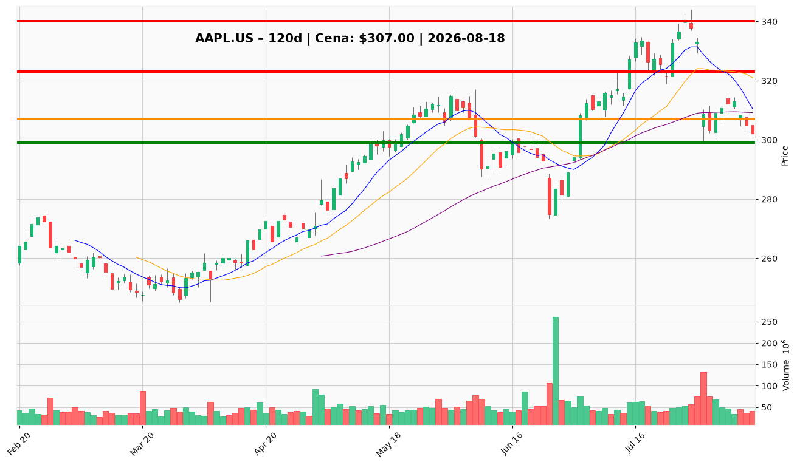

# AAPL.US — Ticket posiadacza (2026-08-18)

**Werdykt:** HOLD
**Horyzont:** swing (dni–tygodnie)
**Cena ref.:** $307.00

| | Poziom | Uwagi |
|---|--------|------|
| **Akcja teraz** | Trzymaj | Bez dokupu na rynku; pozycja zapisana entry $331.24 |
| **Stop-loss** | $299.00 | Twardy — poniżej dołka i strefy $300 |
| **TP1** | $323.00 | Redukcja ~30–40% przy odzyskaniu 50 SMA / środka BB |
| **TP2** | $340.00 | Wyjście reszty przy strefie wcześniejszego oporu |

**Sizing / skala:** Utrzymaj pełną pozycję. Nie dokupuj przy $307 — momentum krótkoterminowe nadal negatywne (MACD bearish, histogram -2.62, cena pod 50 SMA $309), choć stabilizuje się (RSI 43.8, histogram poprawia się 4 sesje). Warunkowy dokup tylko przy odzyskaniu $309 z RSI > 50 i podwyższonym wolumenem (max 1–2% portfela).

**Warunek dokupu** (jeśli ADD): Odzyskanie $309 (50 SMA) z RSI > 50 i potwierdzeniem wolumenu — nie dotyczy obecnego werdyktu HOLD.

**Unieważnienie / pełne wyjście:** Dzienne zamknięcie poniżej $299.00 na podwyższonym wolumenie → redukcja do 50% lub pełne wyjście; przy przełamaniu $292 (dolna wstęga Bollingera) następny poziom wsparcia 200 SMA ~$280.

**Dlaczego (1–2 zdania):** Apple pozostaje fundamentalnie silny (FCF $107,7B, marża 27,6%), a katalizator wrześniowego iPhone'a i otwarcie centrum w Houston wspierają narrację. Technicznie presja sprzedaży utrzymuje się (cena pod 50 SMA), lecz momentum się stabilizuje — histogram MACD poprawia się, RSI rośnie. Przy entry $331.24 pozycja jest pod wodą; trzymaj z dyscypliną SL $299 i czekaj na TP1 $323.

**WERDYKT KOŃCOWY:** HOLD — utrzymaj pozycję, nie dokupuj na rynku, chroń kapitał SL $299, realizuj częściowo przy $323 i $340.

