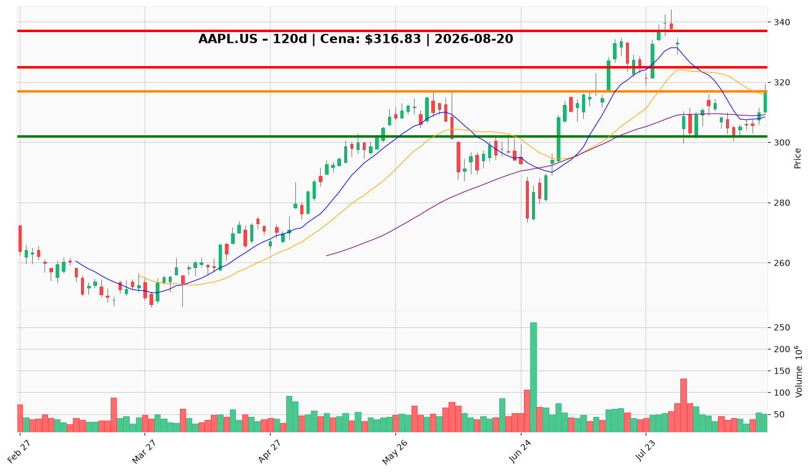

# AAPL.US — Ticket posiadacza (2026-08-20)

**Werdykt:** HOLD
**Horyzont:** swing (dni–tygodnie)
**Cena ref.:** $316.83

| | Poziom | Uwagi |
|---|--------|------|
| **Akcja teraz** | Trzymaj | Bez dokupu na rynku; pozycja zapisana entry $331.24 |
| **Stop-loss** | $302.00 | Twardy — poniżej dołka sierpniowego; unieważnia odbicie |
| **TP1** | $325.00 | Redukcja ~30–40% przy oporze konsolidacji lipcowej |
| **TP2** | $337.00 | Wyjście reszty przy strefie wcześniejszego szczytu |

**Sizing / skala:** Utrzymaj pełną pozycję. Nie dokupuj przy $316.83 — cena między strefą akumulacji $309–$314 a progiem potwierdzenia $320 (wolumen >60M). Warunkowy dokup tylko na limicie $312 (50 SMA / 10 EMA) z połową standardowej wielkości do 26.08 (wyniki Nvidia).

**Warunek dokupu** (jeśli ADD): Limit $312.00 przy cofnięciu do klastra 50 SMA / 10 EMA — nie dotyczy obecnego werdyktu HOLD.

**Unieważnienie / pełne wyjście:** Dzienne zamknięcie poniżej $302.00 → redukcja do 50% lub pełne wyjście; otwiera ruch w kierunku $290.

**Dlaczego (1–2 zdania):** Q3 FY26 przyspiesza (+16,4% przychody, +28,7% EPS, marża brutto 50,1%), trend długoterminowy nienaruszony (cena 13% powyżej 200 SMA), a sentyment wokół iPhone 17 wspiera narrację. Przy entry $331.24 pozycja jest pod wodą, ale odbicie odzyskało 50 SMA ($309) — momentum jeszcze niepotwierdzone (MACD pod sygnałem, niski wolumen). Trzymaj z dyscypliną SL $302 i czekaj na TP1 $325.

**WERDYKT KOŃCOWY:** HOLD — utrzymaj pozycję, nie dokupuj na rynku, chroń kapitał SL $302, realizuj częściowo przy $325 i $337.

