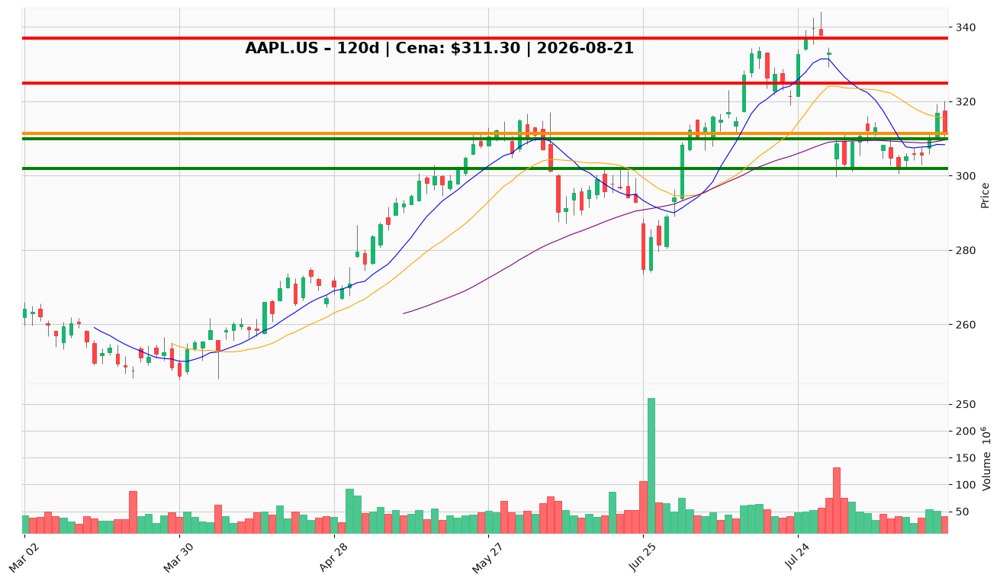

# AAPL.US — Ticket posiadacza (2026-08-21)

**Werdykt:** HOLD
**Horyzont:** swing (dni–tygodnie)
**Cena ref.:** $311.30

| | Poziom | Uwagi |
|---|--------|------|
| **Akcja teraz** | Trzymaj | Bez dokupu na rynku; pozycja zapisana entry $331.24 |
| **Stop-loss** | $302.00 | Twardy — poniżej bazy sierpniowej ($302.30); unieważnia odbicie |
| **TP1** | $325.00 | Redukcja ~30–40% przy oporze konsolidacji |
| **TP2** | $337.00 | Wyjście reszty przy strefie szczytu lipcowego |

**Sizing / skala:** Utrzymaj pełną pozycję. Nie dokupuj przy $311.30 — momentum niepotwierdzone (MACD pod sygnałem, RSI 49, spadający wolumen odbicia). Warunkowy dokup tylko na limicie $308–$310 (klaster 50 SMA / 10 EMA) z połową standardowej wielkości, jeśli cena tam dotrze przed 29.08.

**Warunek dokupu** (jeśli ADD): Limit $308.00–$310.00 przy cofnięciu do 50 SMA ($309.63) — nie dotyczy obecnego werdyktu HOLD.

**Unieważnienie / pełne wyjście:** Dzienne zamknięcie poniżej $302.00 → redukcja do 50% lub pełne wyjście; otwiera ruch w kierunku $290.

**Dlaczego (1–2 zdania):** Fundamenty pozostają silne (marża operacyjna 32,6%, FCF $108B, buybacki $25B/kwartał), a trend długoterminowy nienaruszony (cena +10,8% powyżej 200 SMA). Przy entry $331.24 pozycja jest pod wodą, ale konsolidacja $302–$320 utrzymana — wrzesień (Ternus CEO, iPhone 17) to katalizator, nie powód do wyjścia przed wydarzeniem.

**WERDYKT KOŃCOWY:** HOLD — utrzymaj pozycję, nie dokupuj na rynku, chroń kapitał SL $302, realizuj częściowo przy $325 i $337.

