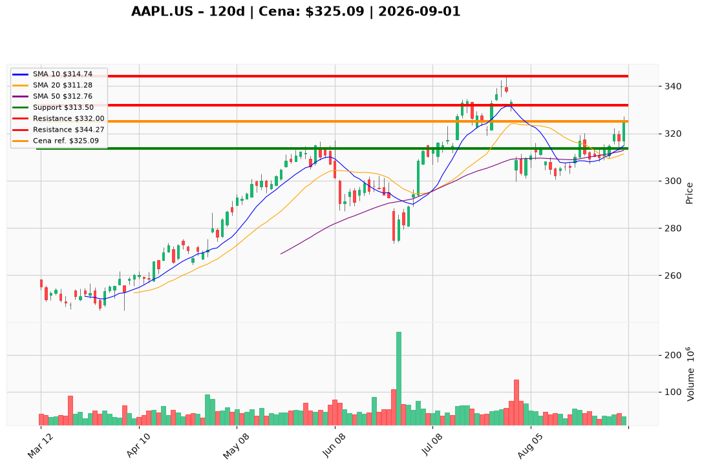

# AAPL.US — Ticket posiadacza (2026-09-01)

**Werdykt:** HOLD
**Horyzont:** swing (dni–tygodnie)
**Cena ref.:** $325.09

| | Poziom | Uwagi |
|---|--------|------|
| **Akcja teraz** | Trzymaj | Utrzymaj obecną ekspozycję; bez dokupu przy $325 |
| **Stop-loss** | $313.50 | trailing — 1,5× ATR, strefa SMA 50 ($312.76) |
| **TP1** | $332.00 | redukcja części przy oporze z 24 lip |
| **TP2** | $344.27 | wyjście reszty przy ATH (29 lip 2026) |

**Pozycja zapisana:** wejście $331.24 | P/L nier.: **−1,9%** (−$6.15/akcję vs cena ref.)

**Sizing / skala:** Utrzymaj obecną wielkość pozycji; nie dokładaj przy $325. Ryzyko max. 1R (~3,5% kapitału) przy SL $313.50.

**Warunek dokupu** (jeśli ADD): Pullback do $312–$316 **lub** potwierdzony breakout powyżej $327.30 przy wolumenie >50M akcji.

**Unieważnienie / pełne wyjście:** Dzienne zamknięcie poniżej $312 przy ujemnym histogramie MACD — wyjście lub istotna redukcja.

**Dlaczego (1–2 zdania):** Fundamenty Apple pozostają silne (FCF $107,7B, wzrost przychodów +16,4% r/r), ale przy 37,2× zysku i PEG 2,58 rally CEO na cienkim wolumenie wchodzi w opór $327–$332–$344 przed binarnym wrześniowym keynote iPhone/Siri. PM i Trader zgodnie: nie sprzedawaj compoundera, ale nie gon za ceną — honoruj stop, skaluj zyski w oporze.

**WERDYKT KOŃCOWY:** HOLD — trzymaj pozycję, SL $313.50, częściowa realizacja przy $332 i $344.27.

