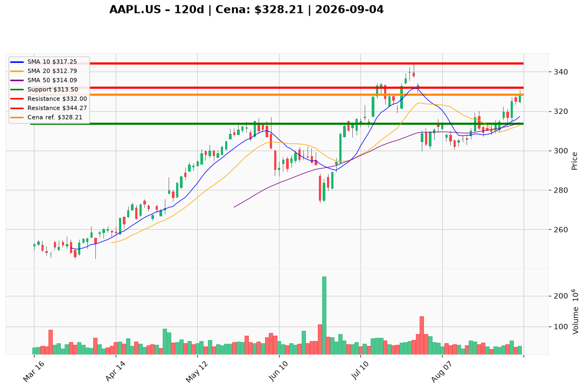

# AAPL.US — Ticket posiadacza (2026-09-04)

**Werdykt:** HOLD
**Horyzont:** swing (dni–tygodnie)
**Cena ref.:** $328.21

**Pozycja zapisana:** wejście $331.24 | P/L: -0.9% (-$3.03)

| | Poziom | Uwagi |
|---|--------|------|
| **Akcja teraz** | Trzymaj | Bez dokupu przy cenie ref. — górna wstęga Bollingera |
| **Stop-loss** | $313.50 | Twardy — poniżej SMA 50 (~$314) |
| **TP1** | $332.00 | Redukcja 30–50% pozycji |
| **TP2** | $344.27 | Wyjście reszty — strefa szczytu 52-tyg. ($344.57) |

**Sizing / skala:** Utrzymaj obecną ekspozycję. Przy TP1 zamknij 30–50%, resztę przy TP2 lub trailing stop $335 po osiągnięciu TP1.

**Warunek dokupu** (jeśli ADD): Pullback do $314–316 (SMA 50 + VWMA) z potwierdzeniem odbicia — nie teraz przy $328.

**Unieważnienie / pełne wyjście:** Zamknięcie dzienne poniżej $313.50 przy podwyższonym wolumenie → EXIT całości.

**Dlaczego (1–2 zdania):** Trend wzrostowy utrzymany (cena powyżej SMA 50/200, MACD byczy), a premiera składanego iPhone'a 9 września to katalizator swingowy. Przy wejściu $331.24 i cenie ref. $328.21 drobna strata (-0.9%) nie uzasadnia wyjścia — trzymaj z dyscypliną SL/TP.

**WERDYKT KOŃCOWY:** HOLD — trzymaj pozycję przez event 9 września, realizuj częściowo przy $332 i $344.27, twardy stop $313.50.

