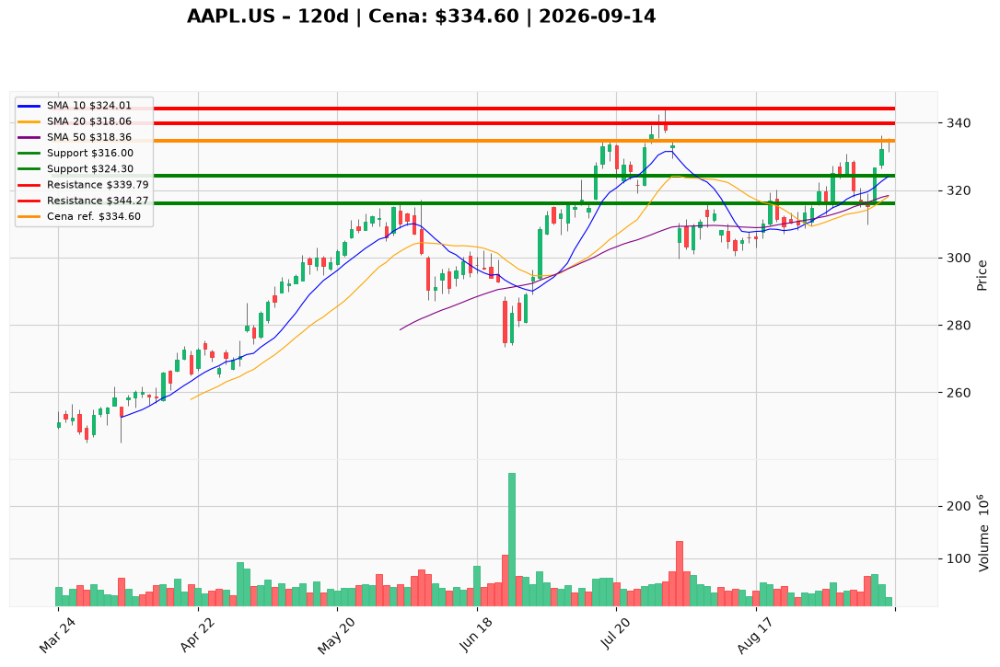

# AAPL.US — Ticket posiadacza (2026-09-14)

**Werdykt:** ADD
**Horyzont:** swing (dni–tygodnie)
**Cena ref.:** $334.60

**Pozycja zapisana:** wejście $331.24 | zapisany SL $313.50 | zapisany TP1 $332.00 (już za nami) | zapisany TP2 $344.27 | P/L nier.: **+1,0%** (+$3.36/akcję)

| | Poziom | Uwagi |
|---|--------|------|
| **Akcja teraz** | Dokup limit @ $324.30 | Trzymaj obecną; nie gon $334.60 (górna BB, lipcowa podaż 329–344) |
| **Stop-loss** | $316.00 | Twardy — zamknięcie dzienne; strefa dołka 9 wrz / SMA 50 (zapisany $313.50 podnieś do $316) |
| **TP1** | $339.79 | Redukcja części — zamknięcie 28 lipca (strefa podaży) |
| **TP2** | $344.27 | Wyjście reszty — szczyt 29 lipca / okolice 52-tyg. (zgodny z zapisem) |

**Sizing / skala:** Utrzymaj obecną ekspozycję. Dokup tylko starter (nie pełny budżet 0,75–1,0% kapitału tradera); jeden ticket, bez drugiego dokupu @ $318.

**Warunek dokupu** (jeśli ADD): Dryf do 10 EMA — limit $324.30. Nie dokupuj przy cenie ref. $334.60 (wolumen 25,2 mln vs 70 mln na rewersji 10 wrz).

**Unieważnienie / pełne wyjście:** Zamknięcie dzienne poniżej $316 na rosnącym wolumenie. Limit dokupu unieważniony, jeśli cena zrobi knot ≥ $334.40 i zamknie się z powrotem poniżej $330 przy rolloverze histogramu MACD zanim wypełni się $324.30.

**Dlaczego (1–2 zdania):** PM Overweight i trader zgodnie: bull stack potwierdzony (334.60 nad rosnącymi 10 EMA / 50 SMA / 200 SMA) po rewersji 10 września, Q3 FY26 mocne. Cena ref. siedzi już w lipcowej podaży — posiadacz z +1,0% trzyma i dokładka wyłącznie na dryf do 10 EMA, nie z rynku.

**WERDYKT KOŃCOWY:** ADD — trzymaj z wejścia $331.24, dokup limit @ $324.30, SL $316.00, TP1 $339.79, TP2 $344.27.

