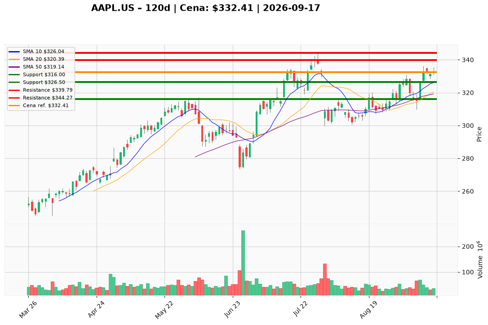

# AAPL.US — Ticket posiadacza (2026-09-17)

**Werdykt:** HOLD
**Horyzont:** swing (dni–tygodnie)
**Cena ref.:** $332.41

**Pozycja zapisana:** wejście $331.24 | zapisany SL $316.00 | zapisany TP1 $339.79 | zapisany TP2 $344.27 | P/L nier.: **+0,4%** (+$1.17/akcję)

| | Poziom | Uwagi |
|---|--------|------|
| **Akcja teraz** | Trzymaj | Nie gon $332.41 (górna BB $336.78, lipcowa podaż 329–344) |
| **Stop-loss** | $316.00 | Twardy — zamknięcie dzienne; strefa dołka 9 wrz / SMA 50 |
| **TP1** | $339.79 | Redukcja części — zamknięcie 28 lipca (strefa podaży) |
| **TP2** | $344.27 | Wyjście reszty — szczyt 29 lipca / okolice 52-tyg. |

**Sizing / skala:** Utrzymaj pełną obecną ekspozycję. Opcjonalny starter dokupu (połowa budżetu 0,5% kapitału) tylko limit @ $326.50 — nie z rynku.

**Warunek dokupu** (opcjonalny): Dryf do 10 EMA — limit $326.50. Nie dokupuj przy cenie ref. $332.41 (wolumen 35,9 mln vs 70 mln na rewersji 10 wrz).

**Unieważnienie / pełne wyjście:** Zamknięcie dzienne poniżej $316 na rosnącym wolumenie. Limit dokupu unieważniony, jeśli cena zrobi knot ≥ $336 i zamknie się z powrotem poniżej $330 przy rolloverze histogramu MACD.

**Dlaczego (1–2 zdania):** PM Hold: bull stack potwierdzony ($332.41 nad rosnącymi 10 EMA / 50 SMA / 200 SMA), iPhone 18 Pro lead times 2–4 tyg. pozytywne, iOS 27 w drodze. Cena ref. w lipcowej podaży na malejącym wolumenie — posiadacz z +0,4% trzyma bez dokupu z rynku; opcjonalny starter tylko na dryf do 10 EMA.

**WERDYKT KOŃCOWY:** HOLD — trzymaj z wejścia $331.24, SL $316.00, TP1 $339.79, TP2 $344.27; opcjonalny dokup limit @ $326.50.

