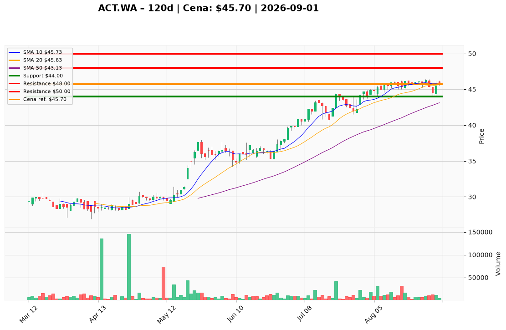

# ACT.WA — Ticket posiadacza (2026-09-01)

**Werdykt:** HOLD
**Horyzont:** pozycja (miesiące; utrzymanie ekspozycji bez dokupu przy szczycie 52-tyg.)
**Cena ref.:** 45,70 PLN
**Pozycja zapisana:** wejście 44,00 PLN (+3,9% nier.)

| | Poziom | Uwagi |
|---|--------|------|
| **Akcja teraz** | Trzymaj | Bez dokupu przy 45,70 PLN; utrzymaj obecną alokację (cap 3–4% portfela) |
| **Stop-loss** | 44,00 PLN | twardy — zamknięcie dzienne poniżej; poniżej sierpniowej konsolidacji i 1× ATR |
| **TP1** | 48,00 PLN | redukcja części po potwierdzeniu wybicia powyżej 46,60 PLN |
| **TP2** | 50,00 PLN | wyjście z reszty przy wznowieniu trendu powyżej oporu |

**Sizing / skala:** 0% nowej alokacji; cap 3–4% portfela (niska płynność WSE ~8–12K szt./dzień). Dokup max +1% kapitału tylko przy pullbacku 44,50–44,70 PLN lub wybiciu >46,60 PLN przy wolumenie >15 000 szt.
**Warunek dokupu** (jeśli ADD): limit 44,60 PLN (strefa popytu 28.08 / dolna Bollinger) lub market powyżej 46,60 PLN przy zamknięciu dziennym z wolumenem >15 000.
**Unieważnienie / pełne wyjście:** zamknięcie dzienne <43,13 PLN (SMA 50) przy RSI <45 → redukcja lub pełne wyjście; plan martwy przy SL 44,00 PLN.

**Dlaczego (1–2 zdania):** Jakościowy dystrybutor IT w długoterminowym trendzie wzrostowym (P/E 13,7×, PEG 0,57, buybacki −22% free float), ale przy 45,70 PLN wycena sprawiedliwa bez marginesu bezpieczeństwa — MACD bearish, trzy nieudane próby przy 46,00–46,40 PLN i słaby wolumen 01.09. PM i trader zgodnie: trzymaj z dyscypliną, nie dokupuj na szczycie.

**WERDYKT KOŃCOWY:** HOLD — utrzymaj pozycję z wejścia 44 PLN, honoruj SL 44,00 PLN, skaluj realizacje na 48 i 50 PLN.

