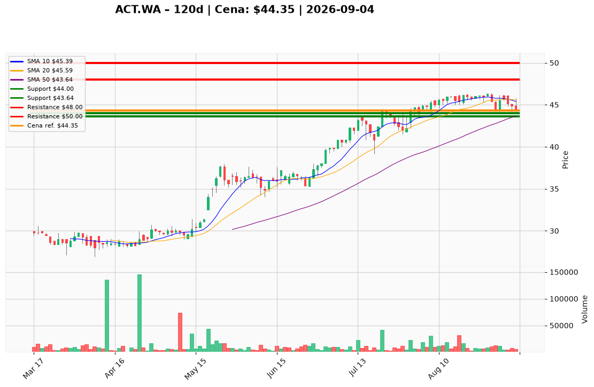

# ACT.WA — Ticket posiadacza (2026-09-04)

**Werdykt:** HOLD
**Horyzont:** Pozycja (tygodnie–miesiące)
**Cena ref.:** 44,35 PLN

**Pozycja zapisana:** wejście 44,00 PLN | P/L: +0,8% (+0,35 PLN/akcję)

| | Poziom | Uwagi |
|---|--------|------|
| **Akcja teraz** | Trzymaj | Bez dokupu — czekaj na powrót powyżej 45,20 PLN (EMA 10) |
| **Stop-loss** | 44,00 PLN | Twardy — wyjście przy zamknięciu poniżej 43,80 PLN |
| **TP1** | 48,00 PLN | Redukcja 30–40% pozycji |
| **TP2** | 50,00 PLN | Wyjście z reszty |

**Sizing / skala:** Utrzymaj obecną ekspozycję. Nie dokupuj przy obecnej cenie — słaba dynamika krótkoterminowa (MACD poniżej sygnału, cena pod EMA 10).

**Warunek dokupu:** Zamknięcie dzienne powyżej 45,20 PLN z rosnącym wolumenem — sygnał stabilizacji po korekcie.

**Unieważnienie / pełne wyjście:** Zamknięcie dzienne poniżej 43,00 PLN (przełamanie SMA 50) przy wzroście wolumenu → przejście na REDUCE/EXIT.

**Dlaczego (1–2 zdania):** Action S.A. utrzymuje silny trend średnioterminowy (cena 29% powyżej SMA 200) przy solidnych fundamentach (P/E 13,3, PEG 0,57, aktywny buyback). Obecna korekta do strefy wejścia 44 PLN jest zdrowa — brak podstaw do wyjścia z pozycji na zero.

**WERDYKT KOŃCOWY:** HOLD — trzymaj pozycję ze stop-loss na zero (44,00 PLN), realizuj częściowo przy 48 PLN, zamykaj resztę przy 50 PLN.

