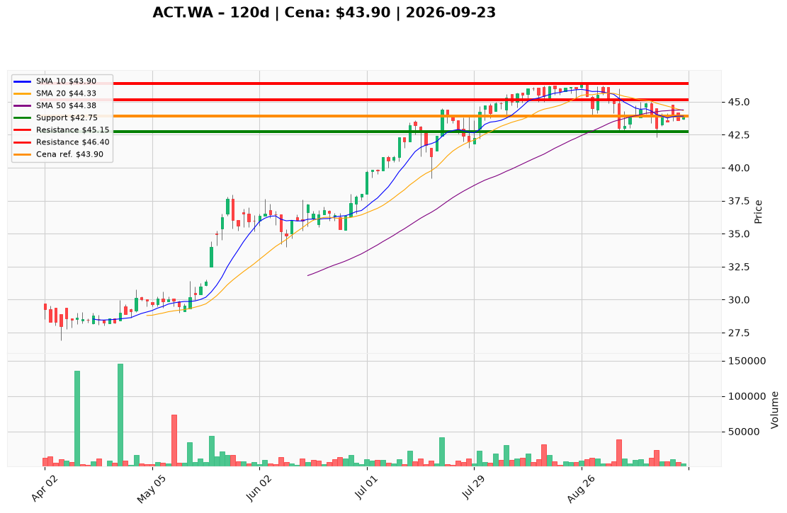

# ACT.WA — Ticket posiadacza (2026-09-23)

**Werdykt:** HOLD
**Horyzont:** pozycja (tygodnie–miesiące)
**Cena ref.:** 43,90 PLN

**Pozycja zapisana (ACT.WA#2):** wejście **45,95 PLN**; SL zapisany brak; TP1 zapisany brak; TP2 zapisany brak.
P/L vs 43,90: **−2,05 PLN (−4,5%)**.

| | Poziom | Uwagi |
|---|--------|------|
| **Akcja teraz** | Trzymaj | bez dokupu @ 43,90; nie sprzedawaj market |
| **Stop-loss** | **42,75 PLN** | twardy — zamknięcie dzienne poniżej dołka z 4 IX |
| **TP1** | **45,15 PLN** | redukcja części przy reclaim SMA 50 / środek Bollingera |
| **TP2** | **46,40 PLN** | reszta przy 52-tyg. high |

**Sizing / skala:** Utrzymaj obecną wielkość lotu ACT.WA#2. Zero nowego kapitału przy 43,90. 43,90 → 42,75 ≈ 2,6% pozycji (~1R); limit orders, cienki arkusz GPW (~4–15k szt.).
**Warunek dokupu:** Brak teraz. ADD dopiero po zamknięciu powyżej **44,38** (SMA 50) z odwróceniem MACD, albo po washout 42,75–43,40 z utrzymaniem 42,75.
**Unieważnienie / pełne wyjście:** Zamknięcie dzienne **<42,75 PLN** na rosnącym zakresie → EXIT, nie uśredniać; następny poziom 41,00–40,85.

**Dlaczego (1–2 zdania):** PM i Trader: HOLD bez dokupu — trend długoterminowy żywy (43,90 nadal +24,5% nad rosnącą SMA 200 = 35,26), fundamenty poprawiają się (EPS TTM 3,59 PLN, ROE 12,79%), buyback aktywny, ale spadek pod SMA 50 (44,38) i ujemny MACD przez 12 sesji nie zasługują na nowy rozmiar. Lot 45,95 jest −4,5% pod wodą — czekamy na odbicie do TP1.

**WERDYKT KOŃCOWY:** **HOLD** — utrzymaj zapisaną pozycję ACT.WA#2 (wejście 45,95; P/L −4,5%) bez dokupu; pracuj SL **42,75** / TP1 **45,15** / TP2 **46,40** PLN.

