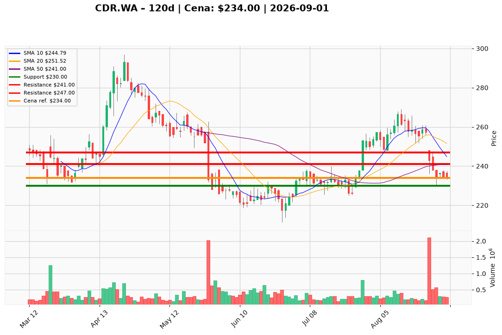

# CDR.WA — Ticket posiadacza (2026-09-01)

**Werdykt:** HOLD
**Horyzont:** tygodnie–miesiące (zarządzanie pozycją; test wsparcia 230 PLN w najbliższych tygodniach)
**Cena ref.:** 234 PLN

| | Poziom | Uwagi |
|---|--------|------|
| **Akcja teraz** | Trzymaj | Bez dokupu; redukcja 25–50% przy odbiciu w strefę 240–242 PLN |
| **Stop-loss** | 230 PLN | twardy — zamknięcie dzienne poniżej; otwiera drogę do 220–211 PLN |
| **TP1** | 241 PLN | pierwsza redukcja części (konwergencja 10 EMA / 50 SMA) |
| **TP2** | 247 PLN | wyjście z reszty przy sile; chyba że zamknięcie dzienne >246–247 przy wolumenie >500K |

**Sizing / skala:** 0% nowej alokacji; obecna ekspozycja −20% vs. normalna (podwyższony ATR 7,57 PLN); trim 25–50% w strefie oporu 240–242 PLN.
**Warunek dokupu** (jeśli ADD): brak — death cross, cena pod średnimi, dystrybucja 25.08 (2,1M szt.); nie dokupować przy 234 PLN.
**Unieważnienie / pełne wyjście:** zamknięcie dzienne <230 PLN → pełne wyjście; kontynuacja spadku w kierunku dołków czerwcowych 220–211 PLN.

**Dlaczego (1–2 zdania):** Potwierdzony krótkoterminowy downtrend po instytucjonalnej dystrybucji; bilans (973M PLN płynności) daje firmie czas, ale nie podłogę ceny przy P/E forward ~147×. PM i trader zgodnie: trzymaj z dyscypliną, bez nowych środków, realizuj część na odbiciu w opór.

**WERDYKT KOŃCOWY:** HOLD — utrzymaj pozycję, honoruj SL 230 PLN, skaluj wyjścia na 241 i 247 PLN jeśli wsparcie wytrzyma.

