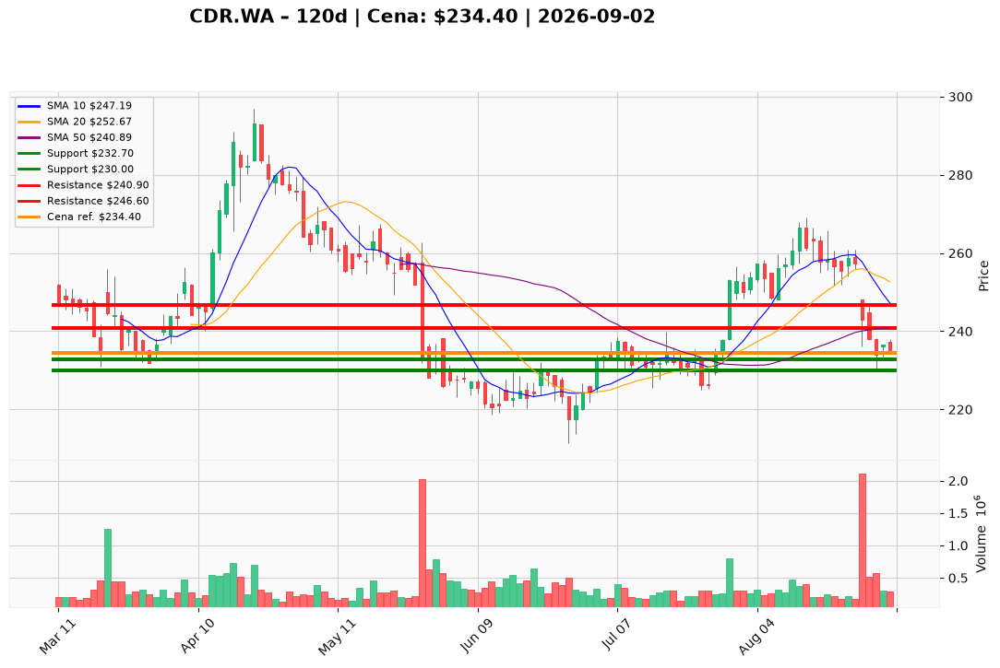

# CDR.WA — Ticket posiadacza (2026-09-02)

---

## Lot 1 — CDR.WA (`position_key: CDR.WA`)

**Pozycja zapisana:** wejście 271,00 PLN · SL zapisany 230,00 PLN · TP1 241,00 PLN · TP2 247,00 PLN

**Werdykt:** HOLD  
**Horyzont:** swing (dni–tygodnie)  
**Cena ref.:** 234,40 PLN  
**P/L vs ref.:** −36,60 PLN (−13,5%)

| | Poziom | Uwagi |
|---|--------|------|
| **Akcja teraz** | Trzymaj | redukcja 25–50% przy odbiciu w strefę 240,90–244,10 PLN |
| **Stop-loss** | 232,70 PLN | twardy — zamknięcie dzienne poniżej unieważnia tezę |
| **TP1** | 240,90 PLN | pierwsza redukcja części (50 SMA) |
| **TP2** | 246,60 PLN | wyjście reszty (200 SMA) |

**Sizing / skala:** 0% nowej alokacji; istniejąca pozycja z ograniczoną ekspozycją — cięcie na oporze, nie dokup przy cenie ref.  
**Unieważnienie / pełne wyjście:** zamknięcie dzienne < 232,70 PLN → cel 225–217 PLN; pełny exit przy utracie poziomu.

**Dlaczego (1–2 zdania):** PM Hold — bilans spółki chroni przed wyjściem awaryjnym, ale momentum jest niedźwiedzie (poniżej wszystkich SMA, rozszerzający się MACD). Przy wejściu 271 PLN pozycja jest głęboko pod wodą; zarządzaj ryzykiem według poziomów tradera/PM, nie zapisanych TP (241/247 są poniżej ceny ref.).

**WERDYKT KOŃCOWY:** HOLD z aktywnym zarządzaniem — cięcie na 240,90–244,10 PLN, twardy SL 232,70 PLN.

---

## Lot 2 — CDR.WA#2 (`position_key: CDR.WA#2`)

**Pozycja zapisana:** wejście 234,00 PLN · SL zapisany 230,00 PLN · TP1 241,00 PLN · TP2 247,00 PLN

**Werdykt:** HOLD  
**Horyzont:** swing (dni–tygodnie)  
**Cena ref.:** 234,40 PLN  
**P/L vs ref.:** +0,40 PLN (+0,17%)

| | Poziom | Uwagi |
|---|--------|------|
| **Akcja teraz** | Trzymaj | redukcja 25–50% przy odbiciu w strefę 240,90–244,10 PLN |
| **Stop-loss** | 232,70 PLN | twardy — zamknięcie dzienne poniżej unieważnia tezę |
| **TP1** | 240,90 PLN | pierwsza redukcja części (50 SMA) |
| **TP2** | 246,60 PLN | wyjście reszty (200 SMA) |

**Sizing / skala:** 0% nowej alokacji; lot blisko breakeven — realizuj zyski warstwowo na oporach, nie dokupuj przy cenie ref.  
**Unieważnienie / pełne wyjście:** zamknięcie dzienne < 232,70 PLN → cel 225–217 PLN; pełny exit przy utracie poziomu.

**Dlaczego (1–2 zdania):** PM Hold — ta sama struktura techniczna co Lot 1, ale wejście 234 PLN daje neutralny P/L. Poziomy tradera/PM (SL 232,70 / TP1 240,90 / TP2 246,60) zastępują zapisane TP1/TP2 (241/247) jako aktualne cele zarządzania.

**WERDYKT KOŃCOWY:** HOLD z aktywnym zarządzaniem — cięcie na 240,90–244,10 PLN, twardy SL 232,70 PLN.

