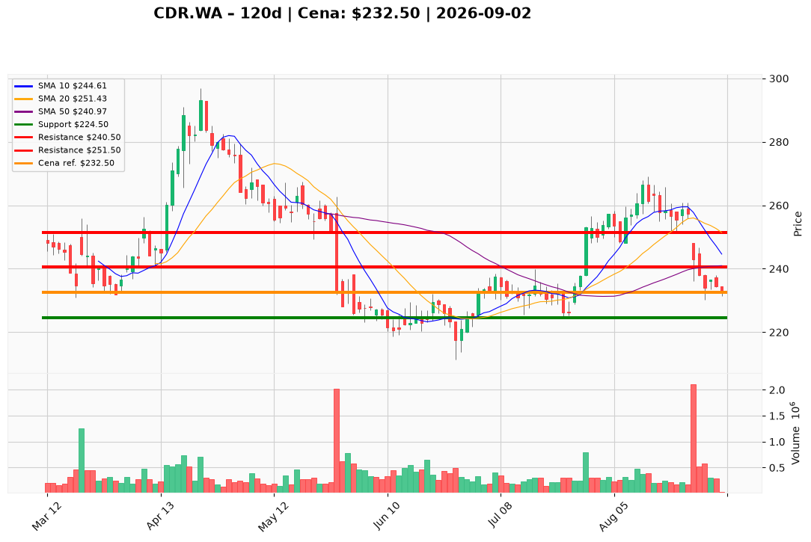

# CDR.WA — Ticket posiadacza (2026-09-02)

---

## Lot 1 — CDR.WA (`position_key: CDR.WA`)

**Pozycja zapisana:** wejście 271,00 PLN · SL zapisany 230,00 PLN · TP1 241,00 PLN · TP2 247,00 PLN

**Werdykt:** HOLD  
**Horyzont:** swing (dni–tygodnie)  
**Cena ref.:** 232,50 PLN  
**P/L vs ref.:** −38,50 PLN (−14,2%)

| | Poziom | Uwagi |
|---|--------|------|
| **Akcja teraz** | Trzymaj | redukcja do 52–55% wcześniejszej wielkości; cięcie 25–50% przy odbiciu w strefę 240,50–245,00 PLN |
| **Stop-loss** | 224,50 PLN | twardy — zamknięcie dzienne poniżej unieważnia tezę swingową |
| **TP1** | 240,50 PLN | pierwsza redukcja części (50 SMA / 10 EMA) |
| **TP2** | 251,50 PLN | wyjście reszty (środek Bollingera / konsolidacja sierpniowa) |

**Sizing / skala:** 0% nowej alokacji przy cenie ref.; istniejąca pozycja — cięcie na oporze, nie dokup przy 232,50 PLN.  
**Warunek dokupu:** limit 226,00 PLN na świecę odwrócenia w strefie 225–229 PLN (RSI > 40), lub breakout przy zamknięciu dziennym > 245,00 PLN przy wolumenie > 400 tys. akcji.  
**Unieważnienie / pełne wyjście:** zamknięcie dzienne < 224,50 PLN → ryzyko zejścia do 225–217 PLN; pełny exit przy utrwalonym zamknięciu < 211,30 PLN (dołek czerwcowy).

**Dlaczego (1–2 zdania):** PM Hold — bilans spółki (3,41 mld PLN kapitału, ~973 mln PLN płynności) ogranicza ryzyko tail, ale momentum jest niedźwiedzie (pięć kolejnych niższych zamknięć, MACD −3,68, brak dywergencji RSI). Przy wejściu 271 PLN pozycja jest głęboko pod wodą; poziomy PM (SL 224,50 / TP1 240,50 / TP2 251,50) zastępują zapisane TP (241/247) jako aktualne cele zarządzania.

**WERDYKT KOŃCOWY:** HOLD z aktywnym zarządzaniem — cięcie na 240,50–245,00 PLN, twardy SL 224,50 PLN.

---

## Lot 2 — CDR.WA#2 (`position_key: CDR.WA#2`)

**Pozycja zapisana:** wejście 234,00 PLN · SL zapisany 230,00 PLN · TP1 241,00 PLN · TP2 247,00 PLN

**Werdykt:** HOLD  
**Horyzont:** swing (dni–tygodnie)  
**Cena ref.:** 232,50 PLN  
**P/L vs ref.:** −1,50 PLN (−0,64%)

| | Poziom | Uwagi |
|---|--------|------|
| **Akcja teraz** | Trzymaj | redukcja do 52–55% wcześniejszej wielkości; cięcie 25–50% przy odbiciu w strefę 240,50–245,00 PLN |
| **Stop-loss** | 224,50 PLN | twardy — zamknięcie dzienne poniżej unieważnia tezę swingową |
| **TP1** | 240,50 PLN | pierwsza redukcja części (50 SMA / 10 EMA) |
| **TP2** | 251,50 PLN | wyjście reszty (środek Bollingera / konsolidacja sierpniowa) |

**Sizing / skala:** 0% nowej alokacji; lot blisko breakeven — realizuj zyski warstwowo na oporach, nie dokupuj przy cenie ref. Zapisany SL 230 PLN jest bliżej ceny niż poziom PM (224,50) — rozważ egzekucję przy 230 PLN jako wcześniejszą ochronę kapitału.  
**Warunek dokupu:** limit 226,00 PLN na świecę odwrócenia w strefie 225–229 PLN (RSI > 40), lub breakout przy zamknięciu dziennym > 245,00 PLN przy wolumenie > 400 tys. akcji.  
**Unieważnienie / pełne wyjście:** zamknięcie dzienne < 224,50 PLN → ryzyko zejścia do 225–217 PLN; pełny exit przy utrwalonym zamknięciu < 211,30 PLN.

**Dlaczego (1–2 zdania):** PM Hold — ta sama struktura techniczna co Lot 1, ale wejście 234 PLN daje prawie neutralny P/L. Cena ref. (232,50 PLN) jest poniżej zapisanych TP1/TP2 (241/247), więc cele PM (240,50 / 251,50) są aktualnym planem wyjścia na odbiciu, nie natychmiastową realizacją.

**WERDYKT KOŃCOWY:** HOLD z aktywnym zarządzaniem — cięcie na 240,50–245,00 PLN, twardy SL 224,50 PLN (lub wcześniejszy przy 230 PLN wg zapisanej ochrony).

