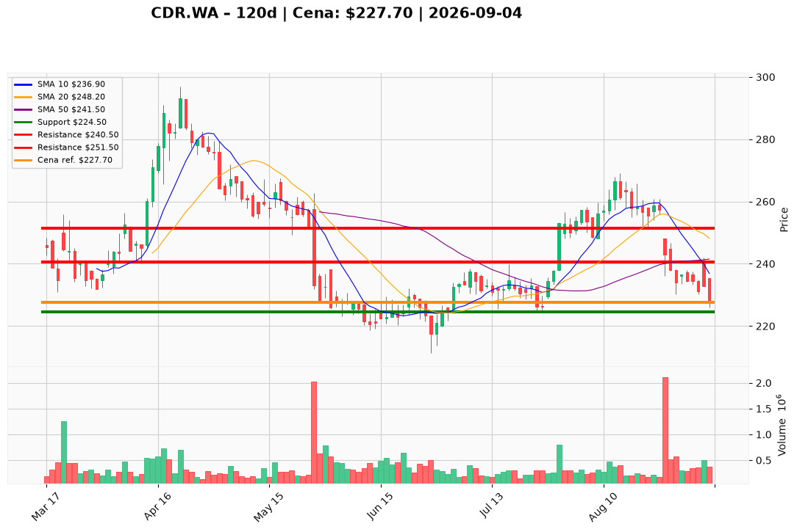

# CDR.WA — Ticket posiadacza (2026-09-04)

**Pozycja zapisana:** wejście 271,00 PLN · SL zapisany 224,50 PLN · TP1 240,50 PLN · TP2 251,50 PLN

**Werdykt:** HOLD  
**Horyzont:** swing (dni–tygodnie)  
**Cena ref.:** 227,70 PLN  
**P/L vs ref.:** −43,30 PLN (−16,0%)

| | Poziom | Uwagi |
|---|--------|------|
| **Akcja teraz** | Trzymaj | redukcja 25–50% przy odbiciu w strefę 240,50–245,00 PLN |
| **Stop-loss** | 224,50 PLN | twardy — zamknięcie dzienne poniżej unieważnia tezę swingową |
| **TP1** | 240,50 PLN | pierwsza redukcja części (50 SMA) |
| **TP2** | 251,50 PLN | wyjście reszty (konsolidacja sierpniowa / środek Bollingera) |

**Sizing / skala:** 0% nowej alokacji przy cenie ref.; istniejąca pozycja — cięcie na oporze, nie dokup przy 227,70 PLN.  
**Warunek dokupu:** zamknięcie dzienne > 245,00 PLN przy wolumenie > 400 tys. akcji, lub limit 226,00 PLN na świecę odwrócenia w strefie 225–229 PLN (RSI > 40).  
**Unieważnienie / pełne wyjście:** zamknięcie dzienne < 224,50 PLN → ryzyko zejścia do 217–222 PLN; pełny exit przy utrwalonym zamknięciu < 211,30 PLN (dołek 52-tyg.).

**Dlaczego (1–2 zdania):** PM Hold — Q2 2026 beat (+44% vs konsensus, marża 80%) i bilans (3,56 mld PLN kapitału) ograniczają ryzyko tail, ale momentum pozostaje niedźwiedzie (MACD −4,30, brak dywergencji RSI, dwudniowy spadek po wynikach). Przy wejściu 271 PLN pozycja −16% pod wodą; poziomy PM (SL 224,50 / TP1 240,50 / TP2 251,50) potwierdzają zapisane cele zarządzania.

**WERDYKT KOŃCOWY:** HOLD z aktywnym zarządzaniem — cięcie na 240,50–245,00 PLN, twardy SL 224,50 PLN.

