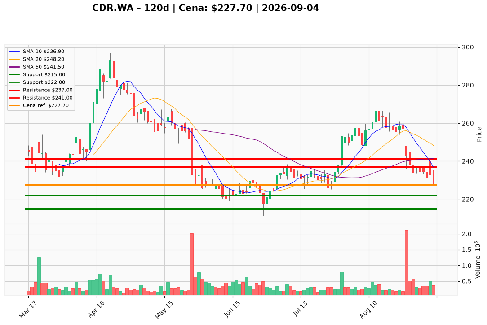

# CDR.WA#2 — Ticket posiadacza (2026-09-04)

**Pozycja zapisana:** wejście 234,00 PLN · SL zapisany 224,50 PLN · TP1 240,50 PLN · TP2 251,50 PLN *(poziomy PM poniżej nadrzędne)*

**Werdykt:** HOLD  
**Horyzont:** swing (dni–tygodnie)  
**Cena ref.:** 227,70 PLN  
**P/L vs ref.:** −6,30 PLN (−2,7%)

| | Poziom | Uwagi |
|---|--------|------|
| **Akcja teraz** | Trzymaj | redukcja 25–50% przy odbiciu w strefę 237,00–241,00 PLN |
| **Stop-loss** | 215,00 PLN | twardy — poniżej dołka czerwcowego (~1,5× ATR od wsparcia) |
| **TP1** | 237,00 PLN | pierwsza redukcja części (odbicie 10 EMA) |
| **TP2** | 241,00 PLN | wyjście reszty (50 SMA / VWMA) |

**Sizing / skala:** 0% nowej alokacji przy cenie ref.; lot #2 — cięcie na oporze, bez dokupu przy 227,70 PLN.  
**Warunek dokupu:** brak — nowe longi odłożone do potwierdzonego utrzymania 222–225 PLN przez dwie sesje z dywergencją RSI.  
**Unieważnienie / pełne wyjście:** zamknięcie dzienne < 222 PLN przy wolumenie > 500 tys. → exit tactical; utrwalone zamknięcie < 215,00 PLN → pełne wyjście lotu #2.

**Dlaczego (1–2 zdania):** PM Hold — Q2 2026 beat (+44% vs konsensus, marża ~93%) i bilans (973M PLN płynności) ograniczają ryzyko tail, ale taśma odrzuca re-rating (nowe lokalne dołki po wynikach, cena pod 10 EMA/50 SMA/200 SMA). Lot #2 przy wejściu 234 PLN lekko pod wodą (−2,7%); PM ustala SL 215 / TP1 237 / TP2 241 jako poziomy zarządzania.

**WERDYKT KOŃCOWY:** HOLD — utrzymaj lot #2, honoruj SL 215,00 PLN, skaluj wyjścia na 237 i 241 PLN przy odbiciu w opór.

