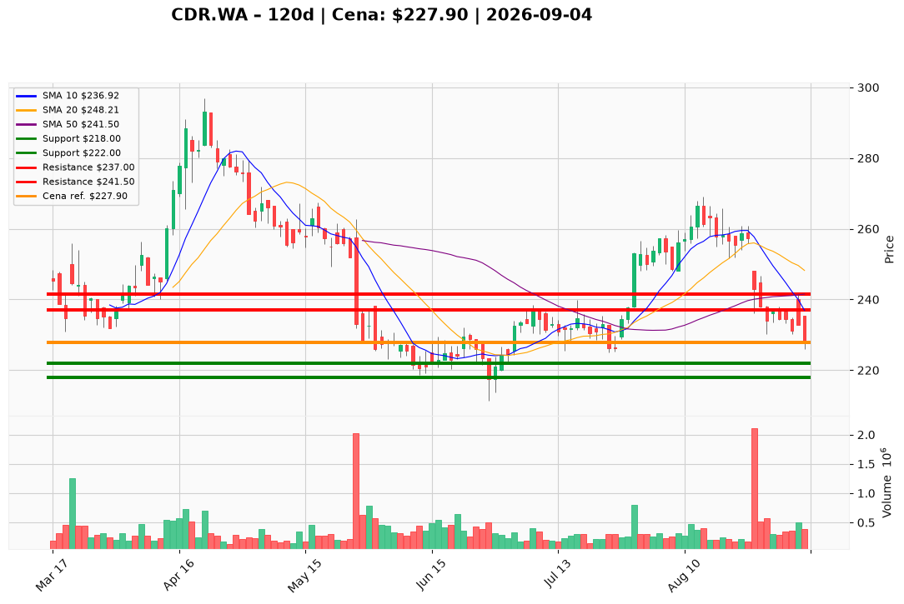

# CDR.WA — Ticket posiadacza (2026-09-04)

---

## Lot 1 — CDR.WA (`position_key: CDR.WA`)

**Pozycja zapisana:** wejście 271,00 PLN · SL zapisany 224,50 PLN · TP1 240,50 PLN · TP2 251,50 PLN *(poziomy PM poniżej nadrzędne)*

**Werdykt:** HOLD  
**Horyzont:** swing (dni–tygodnie)  
**Cena ref.:** 227,90 PLN  
**P/L vs ref.:** −43,10 PLN (−15,9%)

| | Poziom | Uwagi |
|---|--------|------|
| **Akcja teraz** | Trzymaj | bez dokupu przy 227,90 PLN; redukcja ~50% przy odbiciu w 237,00 PLN |
| **Stop-loss** | 218,00 PLN | twardy — poniżej podłogi psychologicznej 220 PLN i strefy naprawy po sierpniowej kapitulacji |
| **TP1** | 237,00 PLN | pierwsza redukcja części (10 EMA / opór po wynikach) |
| **TP2** | 241,50 PLN | wyjście reszty (odbicie 50 SMA); trail SL na breakeven |

**Sizing / skala:** 0% nowej alokacji przy cenie ref.; lot głęboko pod wodą — cięcie na oporze, nie dokup.  
**Warunek dokupu:** brak — nowe longi odłożone do limitu 224,00 PLN po utrzymaniu wsparcia 222–226 PLN przez dwie sesje bez zamknięcia < 222 PLN.  
**Unieważnienie / pełne wyjście:** zamknięcie dzienne < 222,05 PLN (dolna wstęga Bollingera) → teza odbicia martwa, ryzyko zejścia do 211–215 PLN; pełny exit przy SL 218,00 PLN.

**Dlaczego (1–2 zdania):** PM Hold — Q2 2026 beat (+44% vs konsensus, nowa linia franchise/licensing, rekordowy OCF) daje fundament, ale taśma odrzuciła katalizator (gap 3 IX do 240 PLN, zamknięcie 232,7; nowy dołek 226 PLN 4 IX). Cena pod 10 EMA, 50 SMA i 200 SMA z MACD −4,28; przy wejściu 271 PLN pozycja −15,9% — PM ustala SL 218 / TP1 237 / TP2 241,50 jako aktualny plan zarządzania.

**WERDYKT KOŃCOWY:** HOLD — utrzymaj lot, honoruj SL 218,00 PLN, skaluj wyjścia na 237 i 241,50 PLN przy odbiciu.

---

## Lot 2 — CDR.WA#2 (`position_key: CDR.WA#2`)

**Pozycja zapisana:** wejście 234,00 PLN · SL zapisany 215,00 PLN · TP1 237,00 PLN · TP2 241,00 PLN *(poziomy PM poniżej nadrzędne)*

**Werdykt:** HOLD  
**Horyzont:** swing (dni–tygodnie)  
**Cena ref.:** 227,90 PLN  
**P/L vs ref.:** −6,10 PLN (−2,6%)

| | Poziom | Uwagi |
|---|--------|------|
| **Akcja teraz** | Trzymaj | bez dokupu przy 227,90 PLN; redukcja ~50% przy odbiciu w 237,00 PLN |
| **Stop-loss** | 218,00 PLN | twardy — PM nadrzędny wobec zapisanego 215,00 PLN |
| **TP1** | 237,00 PLN | pierwsza redukcja części (10 EMA / opór po wynikach) |
| **TP2** | 241,50 PLN | wyjście reszty (odbicie 50 SMA) |

**Sizing / skala:** 0% nowej alokacji; lot blisko breakeven — realizuj warstwowo na oporach, nie dokupuj przy cenie ref.  
**Warunek dokupu:** brak — potwierdzenie (dwie sesje stabilizacji 222–226 PLN, zwężający histogram MACD) nie zadziałało.  
**Unieważnienie / pełne wyjście:** zamknięcie dzienne < 222,05 PLN → exit taktyczny; utrwalone zejście < 218,00 PLN → pełne wyjście lotu #2.

**Dlaczego (1–2 zdania):** PM Hold — ta sama struktura niedźwiedzia co Lot 1, ale wejście 234 PLN daje lekko ujemny P/L (−2,6%). Zapisany SL 215 PLN jest poniżej poziomu PM (218 PLN) — egzekucja według PM; TP2 PM 241,50 PLN nieznacznie powyżej zapisanego 241,00 PLN.

**WERDYKT KOŃCOWY:** HOLD — utrzymaj lot #2, honoruj SL 218,00 PLN, skaluj wyjścia na 237 i 241,50 PLN.

