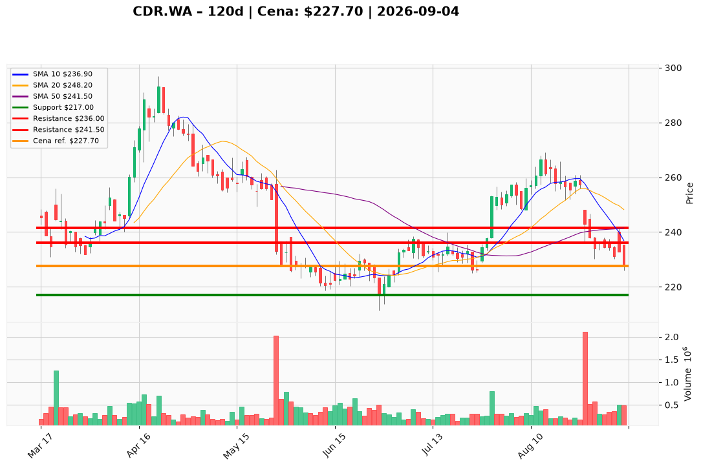

# CDR.WA — Ticket posiadacza (2026-09-04)

**Werdykt:** HOLD  
**Horyzont:** swing (dni–tygodnie)  
**Cena ref.:** 227,70 PLN

## Pozycje zapisane (3 loty)

| Lot | Wejście | Dźwignia | P/L vs 227,70 | Uwagi |
|-----|---------|----------|---------------|-------|
| **CDR.WA** | 271,0 PLN | brak | **−43,3 PLN (−15,9%)** | głęboko pod wodą; SL zapisany 224,5 — poniżej aktualnej ceny |
| **CDR.WA#3** | 234,0 PLN | 2× | **−6,3 PLN (−2,7% / ~−5,4% na marży)** | blisko breakeven; SL zapisany 218,0 |
| **CDR.WA#4** | 238,0 PLN | 2× | **−10,3 PLN (−4,3% / ~−8,6% na marży)** | bliżej wody niż #3; SL zapisany 218,0 |

Lot główny (271 PLN) jest znacząco pod wodą; loty #3 i #4 są bliżej ceny rynkowej, ale oba z dźwignią 2× amplifikują stratę przy spadku poniżej 222 PLN.

## Wspólna tabela akcji (Trader + PM)

| | Poziom | Uwagi |
|---|--------|------|
| **Akcja teraz** | Trzymaj rdzeń | 0% nowego kapitału; redukcja 25–33% już wykonana w strefie 225–228 PLN |
| **Stop-loss** | **217,00 PLN** | twardy — zamknięcie dzienne poniżej unieważnia scenariusz odbicia |
| **TP1** | **236,00 PLN** | pierwsza redukcja części przy odbiciu do strefy 10 EMA |
| **TP2** | **241,50 PLN** | cel rozciągnięty przy odzyskaniu 50 SMA; pełny re-add dopiero po zamknięciu dziennym powyżej |

**Sizing / skala:** Utrzymaj 50–67% poprzedniej pełnej alokacji na wszystkich lotach łącznie; bez dokupu do potwierdzenia kierunku.  
**Warunek dokupu:** Brak — ADD zablokowany do świecy odwrócenia przy 222–225 PLN (RSI >35, wolumen <350K) lub zamknięcia dziennego >241,50 PLN.  
**Unieważnienie / pełne wyjście:** Zamknięcie dzienne <217,00 PLN → EXIT reszty; ścieżka do dołka 52-tyg. ~211,30 PLN. Dodatkowy sygnał ostrzegawczy: zamknięcie <222,00 PLN (dolna wstęga Bollingera).

**Dlaczego (1–2 zdania):** Q2 2026 przyniósł silny beat fundamentalny, ale taśma odrzuciła gap do 240 PLN i zamknęła przy dołku sesji pod pełnym stosem MA (MACD −4,30). Po wykonanej redukcji PM i Trader zgadzają się: nie tnij dalej powyżej 222 PLN, nie dokupuj przed potwierdzeniem — trzymaj z zdefiniowanym ryzykiem.

**WERDYKT KOŃCOWY:** **HOLD** — utrzymaj pozostały rdzeń na trzech lotach z jednym wspólnym SL 217 / TP1 236 / TP2 241,50 PLN; lot 271 PLN wymaga cierpliwości lub akceptacji głębokiej straty papierowej, loty #3/#4 są bliżej neutralnego P/L, ale dźwignia 2× podnosi presję przy spadku pod 222 PLN.

