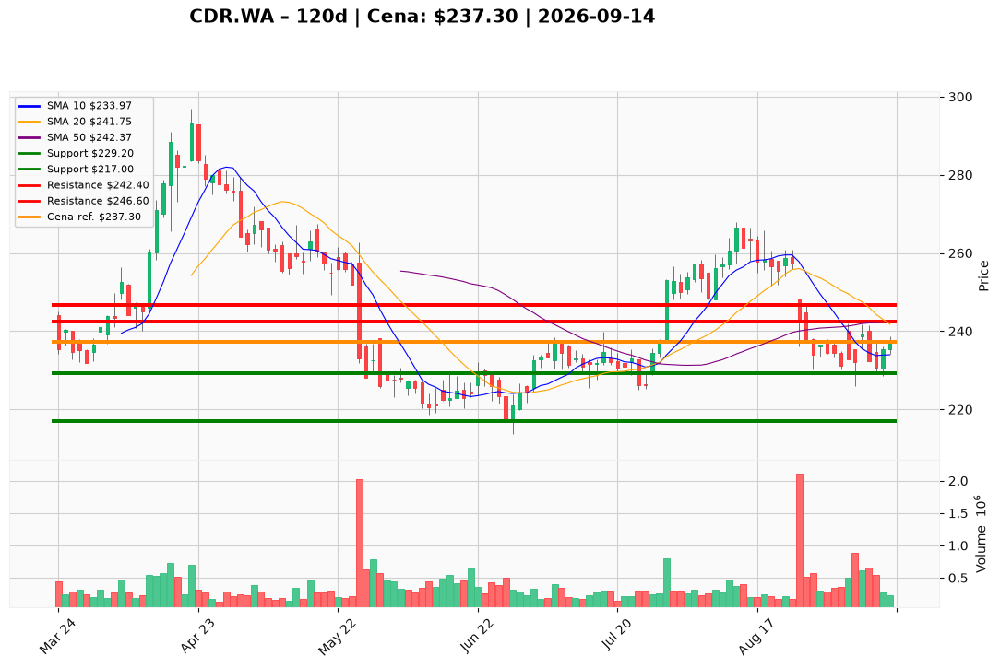

# CDR.WA — Ticket posiadacza (2026-09-14)

**Werdykt:** HOLD  
**Horyzont:** swing (dni–tygodnie)  
**Cena ref.:** 237,30 PLN

**Pozycja zapisana (CDR.WA):** wejście **271,00 PLN**; SL zapisany **217,00 PLN**; TP1 zapisany **236,00 PLN**; TP2 zapisany **241,50 PLN**.  
P/L vs 237,30: **−33,70 PLN (−12,4%)**. Zapisany TP1 236 PLN jest już za rynkiem — na resztę nie jest celem.

| | Poziom | Uwagi |
|---|--------|------|
| **Akcja teraz** | Trzymaj resztę | bez dokupu @ 237,30; nie sprzedawaj market |
| **Stop-loss** | **229,20 PLN** | twardy — zamknięcie dzienne poniżej (PM nadpisuje zapisany 217,00) |
| **TP1** | **242,40 PLN** | redukcja części w strefie 241–243 / 50 SMA (zapisany TP2 241,50 w tej samej strefie) |
| **TP2** | **246,60 PLN** | reszta tylko jeśli 241–243 zaakceptowane na wolumenie; 200 SMA |

**Sizing / skala:** Tylko resztka; ryzyko ≤0,75% kapitału do 229,20 (~8,1 PLN / ~1,0R). Zero nowego kapitału.  
**Warunek dokupu:** Brak — ADD zablokowany przy 237,30. Odwrócenie biasu dopiero przy zamknięciu dziennym przez 246,60–247,00 na 400–600k+ wolumenu.  
**Unieważnienie / pełne wyjście:** Zamknięcie dzienne <229,20 PLN na ~500k+ wolumenu → EXIT reszty (ścieżka 220, potem 211–217).

**Dlaczego (1–2 zdania):** PM i Trader: HOLD bez dokupu — bounce do 241–243 jest dopuszczalny, ale death-cross 50<200 i cienki wolumen (229k vs gap 2,11m) wykluczają nowy long. Lot 271 jest głęboko pod wodą; nie uśredniać.

**WERDYKT KOŃCOWY:** **HOLD** — utrzymaj zapisaną pozycję CDR.WA (wejście 271,00; P/L −12,4%) bez dokupu; pracuj SL **229,20** / TP1 **242,40** / TP2 **246,60** PLN (zapisane 217 / 236 / 241,50: TP1 już za nami, SL 217 zastąpiony twardszym 229,20).

