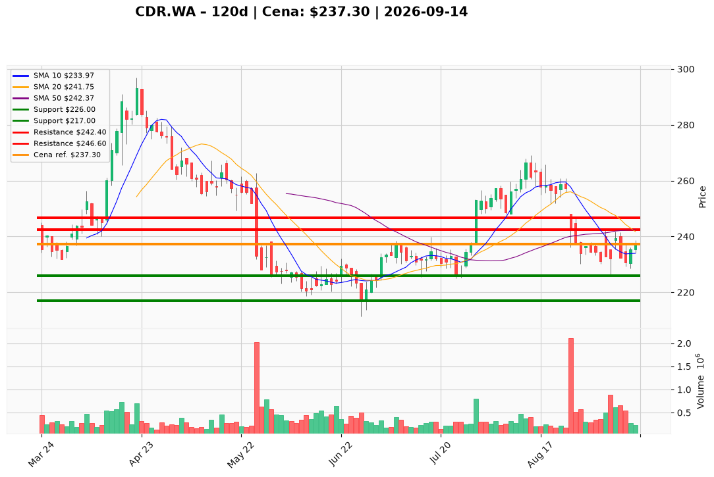

# CDR.WA — Ticket posiadacza (2026-09-14)

**Werdykt:** HOLD  
**Horyzont:** swing (dni–tygodnie)  
**Cena ref.:** 237,30 PLN

**Pozycja zapisana:** `CDR.WA#3` — wejście **234,00 PLN**, dźwignia **2×**, status OWNED. Zapisane poziomy: SL 217,00 / TP1 236,00 / TP2 241,50. P/L vs ref.: **+3,30 PLN (+1,4% na kursie, ~+2,8% na marży)**. Zapisany TP1 236,00 jest już za ceną — nie tnij teraz; PM każe trzymać rdzeń do strefy 241,7–243,0.

| | Poziom | Uwagi |
|---|--------|------|
| **Akcja teraz** | Trzymaj | 0% dokupu @ 237,30; nie redukuj na pierwszej konstruktywnej sesji |
| **Stop-loss** | **226,00 PLN** | twardy (dołek 4 IX / ~1,5 ATR); PM nadpisuje zapisane 217,00 |
| **TP1** | **242,40 PLN** | redukcja części w zbiegu 50 SMA / środek Bollingera (241,7–243,0) |
| **TP2** | **246,60 PLN** | reszta przy 200 SMA, tylko jeśli wolumen przebije 242,40 |

**Sizing / skala:** Bez dokładania do tego lotu przy 237,30 (z ref. ~5 PLN nagrody vs ~11 PLN ryzyka do 226 — słabe R). Ryzyko robocze 11,30 PLN (~4,8% kursu; przy 2× ~9,6% marży) — trzymaj jednostkę tak, by luka ≈ 1R (ok. 0,5–0,75% kapitału). Nie trailuj rdzenia pod 234,00.

**Warunek dokupu:** Brak teraz. Opcjonalny mniejszy add dopiero po zamknięciu dziennym >242,40 przy rosnącym wolumenie (wtedy SL 234,00) albo po teście 226–231, który utrzyma 220 (SL 221,00) — nie drugi pełny lot.

**Unieważnienie / pełne wyjście:** Zamknięcie dzienne <226,00 PLN → EXIT. Trzecie odrzucenie 241–243 z zamknięciem z powrotem <236,00 → trim, nie uśrednianie w górę.

**Dlaczego (1–2 zdania):** Jakość (Q2 net 142,9 mln PLN, marża op. 60,6%, ~80–90% pozytywnego pokrycia) nie każe wychodzić, ale wycena (forward P/E 149) i FCF −141 mln nie każe dokładać pod dwukrotnie oblaną półkę 241,7–243,0. Trader i PM: Hold — skaluj w podaż, nie gonić 237,30.

**WERDYKT KOŃCOWY:** **HOLD** — lot `CDR.WA#3` (wejście 234,00, 2×) zostaje; roboczy SL **226,00** / TP1 **242,40** / TP2 **246,60** PLN (zapisane 217 / 236 / 241,50 zaktualizowane wg PM); bez dokupu i bez trimu przy 237,30.

