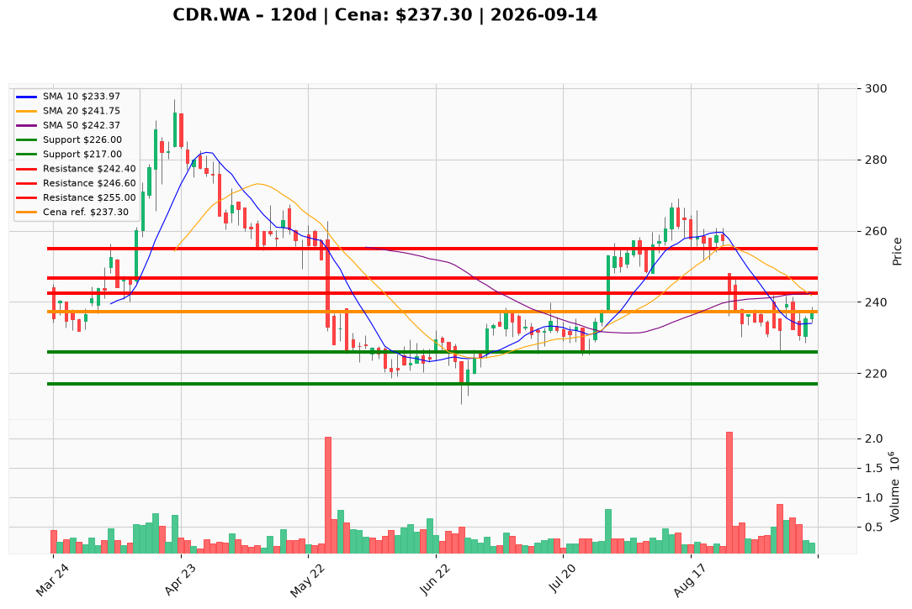

# CDR.WA — Ticket posiadacza (2026-09-14)

**Werdykt:** HOLD  
**Horyzont:** swing (dni–tygodnie)  
**Cena ref.:** 237,30 PLN

**Pozycja zapisana:** `CDR.WA#4` — wejście **238,00 PLN**, status OWNED. Zapisane poziomy: SL 217,00 / TP1 236,00 / TP2 241,50. P/L vs ref.: **−0,70 PLN (−0,3%)**. Zapisany TP1 236,00 jest już za ceną — nie tnij teraz.

| | Poziom | Uwagi |
|---|--------|------|
| **Akcja teraz** | Trzymaj | bez dokupu @ 237,30; nie sprzedawaj market |
| **Stop-loss** | **226,00 PLN** | twardy — zamknięcie dzienne poniżej dołka 4 IX (~1,5 ATR); PM nadpisuje zapisane 217,00 |
| **TP1** | **246,60 PLN** | redukcja części przy 200 SMA; nie skaluj w 241,50–242,40 (to strefa dokupu/50 SMA) |
| **TP2** | **255,00 PLN** | reszta tylko jeśli 246,59 utrzymane na zamknięciu |

**Sizing / skala:** Tylko zapisany lot; zero nowego kapitału przy 237,30. Ryzyko robocze 12,00 PLN do 226,00 (~5,0% kursu) — trzymaj jednostkę tak, by luka ≈ 0,5–1,0% kapitału (1R). Nowy kapitał dopiero od 242,40, wtedy 0,5–1,0% equity (16,4 PLN do 226).

**Warunek dokupu:** Opcjonalny ADD dopiero po zamknięciu dziennym **>242,40 PLN** (50 SMA / środek Bollingera) przy wolumenie >~400k lub MACD histogram przez zero. Nie gonić 237,30; nie uśredniać w dół.

**Unieważnienie / pełne wyjście:** Zamknięcie dzienne <226,00 PLN → EXIT. Strefa 242–247 oblana na rosnącym wolumenie przy RSI <50 i histogramie MACD z powrotem poniżej −1,5 → plan martwy (trim, nie dokup).

**Dlaczego (1–2 zdania):** PM i Trader: Buy wyłącznie na potwierdzeniu — jakość Q2 (NI 142,9 mln, marża op. ~60,6%) nie każe wychodzić z lotu 238, ale death-cross 50/200 i cienki wolumen (229k vs 2,11m) wykluczają gonienie 237,30. Zapisany TP2 241,50 zderza się z poziomem dokupu 242,40 — PM każe trzymać rdzeń do 246,60 / 255.

**WERDYKT KOŃCOWY:** **HOLD** — lot `CDR.WA#4` (wejście 238,00; P/L −0,3%) zostaje bez dokupu i bez trimu przy 237,30; roboczy SL **226,00** / TP1 **246,60** / TP2 **255,00** PLN (zapisane 217 / 236 / 241,50: TP1 już za nami, SL 217 zastąpiony twardszym 226,00); ADD tylko po close >242,40.

