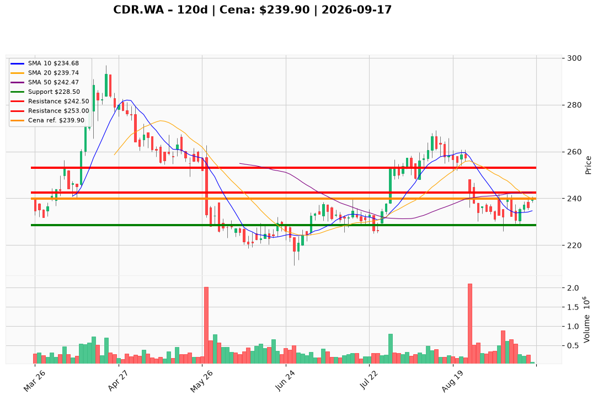

# CDR.WA — Ticket posiadacza (2026-09-17)

**Werdykt:** HOLD
**Horyzont:** swing (dni–tygodnie)
**Cena ref.:** 239,9 PLN

**Pozycja zapisana:** wejście 271,0 PLN → niezrealizowana strata ~−11,5% (−31,1 PLN/akcję)

| | Poziom | Uwagi |
|---|--------|------|
| **Akcja teraz** | Trzymaj core | Nie dokupuj @ 239,9 PLN; redukcja 25–50% przy 242–247 PLN |
| **Stop-loss** | 228,5 PLN | Twardy — poniżej dołka z 10.09 i strefy 228–232 |
| **TP1** | 242,5 PLN | Pierwsza redukcja przy SMA 50; trim 25–50% pozycji |
| **TP2** | 253,0 PLN | Cel rozciągnięty — lokalne maksimum z lipca po przełamaniu SMA 50/200 |

**Sizing / skala:** Utrzymaj rdzeń pozycji; nie dodawaj kapitału w „no man's land” między wsparciem i oporem. Nowe środki tylko przy pullbacku do 232–235 PLN lub zamknięciu >242,5 PLN przy wolumenie >400K.

**Warunek dokupu** (jeśli ADD): Pullback do 232–235 PLN ze stop-loss 228,5 PLN (ryzyko max 1,0–1,5% kapitału).

**Unieważnienie / pełne wyjście:** Dzienne zamknięcie <228 PLN przy wolumenie — otwiera 221 PLN i unieważnia odbicie ze września.

**Dlaczego (1–2 zdania):** Beat Q2 (+44% vs konsensus) i poprawa sentymentu wspierają stabilizację, ale death cross, forward P/E ~151× i asymetryczny downside (12–19 PLN do 228–221 vs ~3 PLN do SMA 50) przeważają — utrzymaj, nie dokupuj, redukuj część w strefie oporu 242–247 PLN.

**WERDYKT KOŃCOWY:** HOLD — trzymaj rdzeń, nie dokupuj @ 239,9 PLN; redukcja 25–50% przy 242,5–247 PLN; SL 228,5 PLN.

