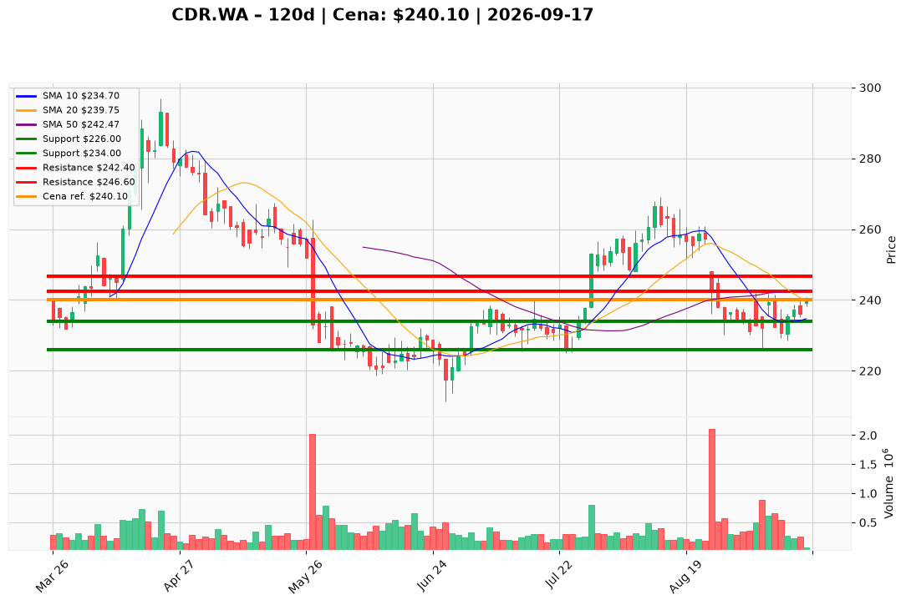

# CDR.WA — Ticket posiadacza (2026-09-17)

**Werdykt:** HOLD  
**Horyzont:** swing (dni–tygodnie)  
**Cena ref.:** 240,10 PLN

**Pozycja zapisana:** `CDR.WA#3` — wejście **234,00 PLN**, status OWNED. Zapisane poziomy: SL 226,00 / TP1 242,40 / TP2 246,60. P/L vs ref.: **+6,10 PLN (+2,6%)**. TP1 242,40 to 0,9% powyżej ceny — strefa częściowej realizacji.

| | Poziom | Uwagi |
|---|--------|------|
| **Akcja teraz** | Trzymaj | bez dokupu @ 240,10; opcjonalny trim 30% przy TP1 na słabym wolumenie |
| **Stop-loss** | **226,00 PLN** | twardy — zamknięcie dzienne poniżej dołka 4 IX |
| **TP1** | **242,40 PLN** | redukcja 30% przy wolumenie <300k; pełna przy silnym odrzuceniu |
| **TP2** | **246,60 PLN** | reszta przy 200 SMA po utrzymaniu TP1 |

**Sizing / skala:** Tylko zapisany lot `CDR.WA#3`; zero nowego kapitału przy 240,10. Ryzyko robocze 14,10 PLN do 226,00 (~5,9% kursu) — trzymaj jednostkę tak, by luka ≈ 0,5–1,0% kapitału (1R). Nowy kapitał dopiero po close >242,47 z wolumenem >400k.

**Warunek dokupu:** ADD tylko po zamknięciu dziennym **>242,47 PLN** (50 SMA) przy wolumenie >400k lub MACD line powyżej signal line. Nie gonić 240,10; nie uśredniać w dół.

**Unieważnienie / pełne wyjście:** Zamknięcie dzienne <226,00 PLN → EXIT. Strefa 242–247 oblana na rosnącym wolumenie przy RSI <50 i histogramie MACD <−1,0 → plan martwy (trim, nie dokup).

**Dlaczego (1–2 zdania):** PM Hold: Q2 beat (NI 142,9 mln, marża ~60%) i pozytywne newsy (900k wishlist Witcher DLC) wspierają trzymanie lotu 234, ale death-cross 50/200 i wolumen 69k (vs 892k na dołku) wykluczają dokup @ 240,10. MACD histogram +0,09 i reclaim 10 EMA to wczesny sygnał naprawy — TP1 242,40 za rogiem.

**WERDYKT KOŃCOWY:** **HOLD** — lot `CDR.WA#3` (wejście 234,00; P/L +2,6%) zostaje bez dokupu przy 240,10; roboczy SL **226,00** / TP1 **242,40** / TP2 **246,60** PLN; opcjonalny trim 30% przy TP1 na słabym wolumenie; ADD tylko po close >242,47.

