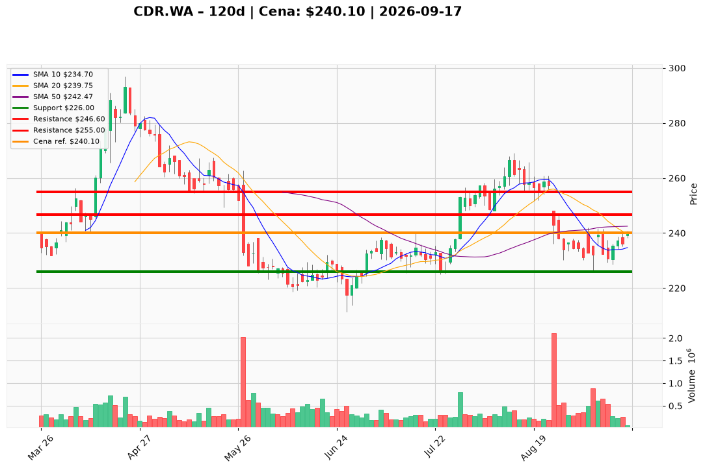

# CDR.WA — Ticket posiadacza (2026-09-17)

**Werdykt:** HOLD
**Horyzont:** swing (dni–tygodnie)
**Cena ref.:** 240.10 PLN

| | Poziom | Uwagi |
|---|--------|------|
| **Akcja teraz** | Trzymaj | Pozycja zapisana @ 238.0 PLN (+0.9% P/L) |
| **Stop-loss** | 226.0 PLN | twardy — poniżej dołka z 4 IX |
| **TP1** | 246.6 PLN | redukcja ~30% przy 200 SMA |
| **TP2** | 255.0 PLN | wyjście z reszty — strefa sierpniowa |

**Sizing / skala:** Utrzymaj pełną pozycję lot CDR.WA#4. Bez dokupu powyżej 242.5 PLN (50 SMA). Ryzyko: ~12 PLN/akcję (238→226).

**Warunek dokupu** (jeśli ADD): Pullback do 235–236 PLN (10 EMA) z potwierdzeniem wolumenem — na razie nieaktywny.

**Unieważnienie / pełne wyjście:** Zamknięcie dzienne poniżej 226.0 PLN na podwyższonym wolumenie — wyjście z całości.

**Dlaczego (1–2 zdania):** Mocne wyniki Q2 2026 (+44% vs konsensus) i przychody z licencji wspierają trzymanie, ale cena wciąż pod 50/200 SMA ogranicza agresję. Odbicie z 226 z pozytywnym histogramem MACD daje szansę na test 246–255 w horyzoncie swing.

**WERDYKT KOŃCOWY:** HOLD — trzymaj lot @ 238.0 PLN, SL 226.0, TP1 246.6, TP2 255.0

