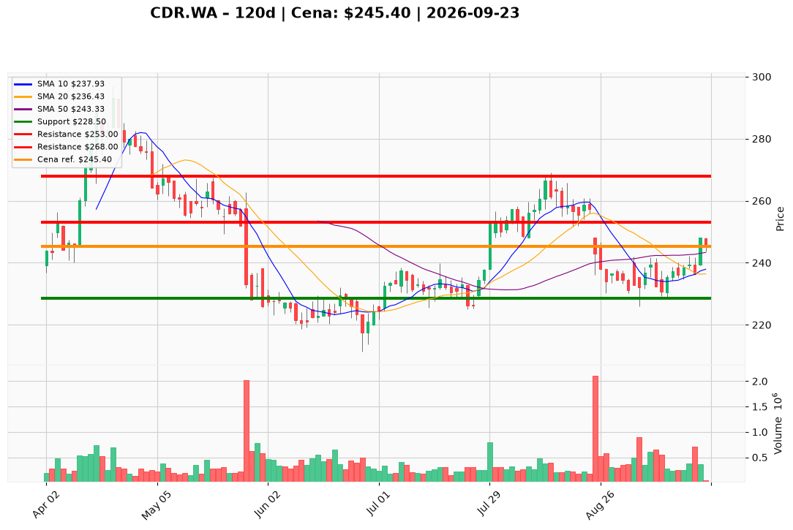

# CDR.WA — Ticket posiadacza (2026-09-23)

**Werdykt:** HOLD
**Horyzont:** swing (dni–tygodnie)
**Cena ref.:** 245.4 PLN

| | Poziom | Uwagi |
|---|--------|------|
| **Akcja teraz** | Trzymaj | Brak dokupu — czekaj na przełamanie 253 PLN z wolumenem |
| **Stop-loss** | 228.5 PLN | Twardy — poniżej dołka z 11.09 (228.6) |
| **TP1** | 253.0 PLN | Redukcja 30–40% pozycji |
| **TP2** | 268.0 PLN | Kolejna redukcja 30–40% — strefa wypełnienia luki sierpniowej |

**Pozycja zapisana:** wejście 271.0 PLN | SL 228.5 | TP1 253.0 | TP2 268.0
**Niezrealizowany P/L:** -9.5% względem ceny ref.

**Sizing / skala:** Utrzymaj pełną pozycję. Przy TP1 sprzedaj 30–40%, resztę prowadź do TP2 z trailingiem.
**Warunek dokupu:** Zamknięcie dzienne powyżej 253 PLN z wolumenem >300 tys. — wtedy rozważ dokup max 25% pozycji.
**Unieważnienie / pełne wyjście:** Zamknięcie dzienne poniżej 228.5 PLN — wyjście z całości.

**Dlaczego (1–2 zdania):** Wyniki Q2 (+44% vs konsensus, marża netto 80%) i odwrócenie MACD wspierają cierpliwość. Akcja odbudowuje się technicznie (powyżej SMA50), ale wciąż poniżej SMA200 — nie dodawaj, trzymaj z dyscypliną SL/TP.

**WERDYKT KOŃCOWY:** HOLD — trzymaj pozycję, nie dokupuj do przełamania 253 PLN; realizuj częściowo przy 253 i 268 PLN.

