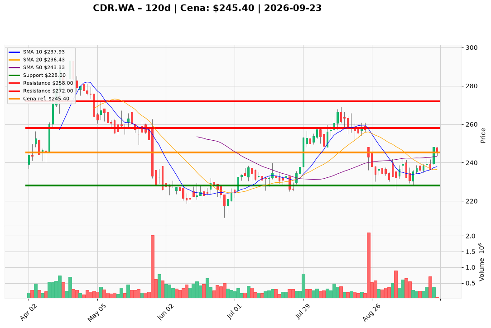

# CDR.WA — Ticket posiadacza (2026-09-23)

**Werdykt:** HOLD
**Horyzont:** swing (dni–tygodnie)
**Cena ref.:** 245.40 PLN

**Pozycja zapisana (CDR.WA#5):** wejście 249.00 PLN | P/L: −1.4% (−3.60 PLN/akcję)

| | Poziom | Uwagi |
|---|--------|------|
| **Akcja teraz** | Trzymaj | Bez dokupu — czekaj na potwierdzenie powyżej 248 PLN |
| **Stop-loss** | 228.00 PLN | Twardy — pod wrześniowym dołkiem (double-bottom) |
| **TP1** | 258.00 PLN | Redukcja 30–40% pozycji (strefa luki sierpniowej) |
| **TP2** | 272.00 PLN | Wyjście z reszty (opór z lipca) |

**Sizing / skala:** Utrzymaj obecną wielkość lotu; nie dokupuj bez breakoutu >248 PLN na wolumenie. Ryzyko do SL: ~7% od ceny ref.

**Warunek dokupu:** Zamknięcie dzienne >248 PLN z wolumenem powyżej średniej 20-sesyjnej — wtedy rozważ dokup max 10–15% pozycji.

**Unieważnienie / pełne wyjście:** Zamknięcie dzienne <228 PLN na podwyższonym wolumenie — wyjście z całej pozycji.

**Dlaczego (1–2 zdania):** Q2 2026 beat (+44% vs konsensus), rosnące przychody z franczyz i odbicie techniczne (MACD+, powyżej SMA50) wspierają cierpliwość. Spadek gotówki i P/E ~42 ograniczają agresję — przy wejściu 249 PLN sensowne jest trzymanie z twardym SL zamiast panicznej redukcji.

**WERDYKT KOŃCOWY:** HOLD — trzymaj pozycję z SL 228 PLN, realizuj częściowo przy 258 i 272 PLN.

