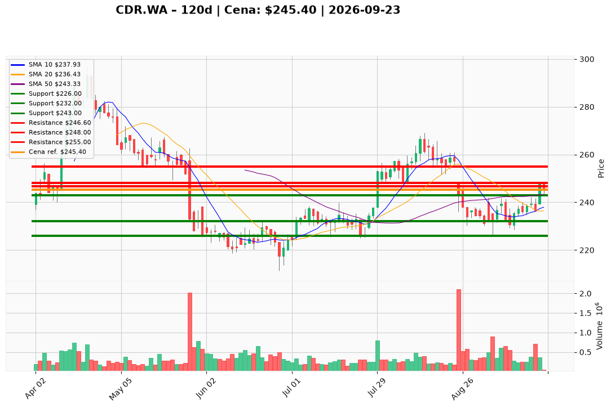

# CDR.WA — Ticket posiadacza (2026-09-23)

**Werdykt:** HOLD
**Horyzont:** swing (dni–tygodnie)
**Cena ref.:** 245.4 PLN

| | Poziom | Uwagi |
|---|--------|------|
| **Akcja teraz** | Trzymaj | Pozycja zapisana @ 238.0 PLN (+3.1% P/L) |
| **Stop-loss** | 226.0 PLN | twardy — poniżej dołka z 4 IX |
| **TP1** | 246.6 PLN | redukcja ~30% przy 200 SMA |
| **TP2** | 255.0 PLN | wyjście z reszty — strefa sierpniowa |

**Sizing / skala:** Utrzymaj pełną pozycję lot CDR.WA#4. Bez dokupu powyżej 248.0 PLN (200 SMA + szczyt z 21 IX). Ryzyko: ~19 PLN/akcję (245→226).

**Warunek dokupu** (jeśli ADD): Zamknięcie dzienne > 248.0 PLN przy wolumenie > 400 tys. — na razie nieaktywny.

**Unieważnienie / pełne wyjście:** Zamknięcie dzienne poniżej 226.0 PLN na podwyższonym wolumenie — wyjście z całości.

**Dlaczego (1–2 zdania):** Mocne wyniki Q2 2026 (+44% vs konsensus) i pozytywny histogram MACD wspierają trzymanie; cena odzyskała 50 SMA i testuje 200 SMA (246.4). Odrzucenie przy 248.0 ogranicza agresję — HOLD z dyscypliną SL/TP.

**WERDYKT KOŃCOWY:** HOLD — trzymaj lot @ 238.0 PLN, SL 226.0, TP1 246.6, TP2 255.0

