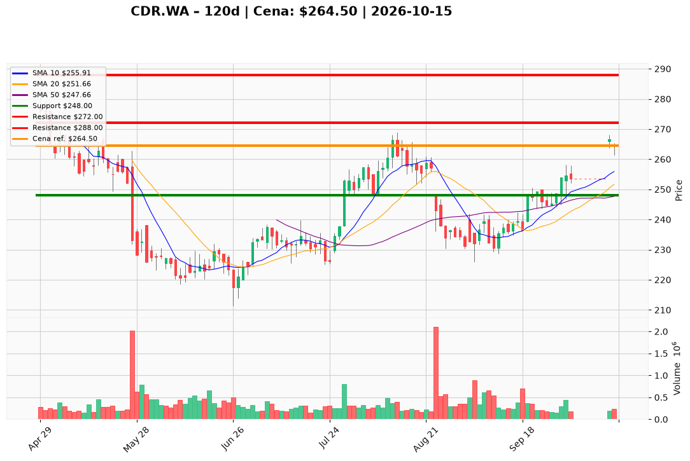

# CDR.WA — Ticket posiadacza (2026-10-15)

**Werdykt:** HOLD
**Horyzont:** swing (dni–tygodnie)
**Cena ref.:** 264.5 PLN

| | Poziom | Uwagi |
|---|--------|------|
| **Akcja teraz** | Trzymaj | Pozycja zapisana @ 271.0 PLN (−2,4% P/L vs ref.) |
| **Stop-loss** | 248.0 PLN | twardy taktyczny — pod bazą przed lucem i strefą 50 SMA |
| **TP1** | 272.0 PLN | redukcja ~30% przy zbliżeniu do zera z 271 |
| **TP2** | 288.0 PLN | wyjście z reszty — strefa szczytów z I 2026 |

**Sizing / skala:** Utrzymaj pełny lot CDR.WA. Bez dokupu bez zamknięcia dziennego > 268.0 PLN (szczyt z 14 X + potwierdzenie wolumenu). Ryzyko od ref.: ~16,5 PLN/akcję (264,5→248).

**Warunek dokupu** (jeśli ADD): Zamknięcie dzienne > 268.0 PLN przy wolumenie > 250 tys. — na razie nieaktywny (RSI > 70).

**Unieważnienie / pełne wyjście:** Zamknięcie dzienne poniżej 248.0 PLN na podwyższonym wolumenie — wyjście z całości.

**Dlaczego (1–2 zdania):** Luka po newsach o remasterze Wiedźmina 3 i dodatni histogram MACD wspierają trzymanie po wybiciu z konsolidacji ~253 PLN; przy wejściu 271 PLN celem jest odrobienie straty przy TP1/TP2, bez dokupu w strefie wykupienia.

**WERDYKT KOŃCOWY:** HOLD — trzymaj lot @ 271.0 PLN, SL 248.0, TP1 272.0, TP2 288.0

