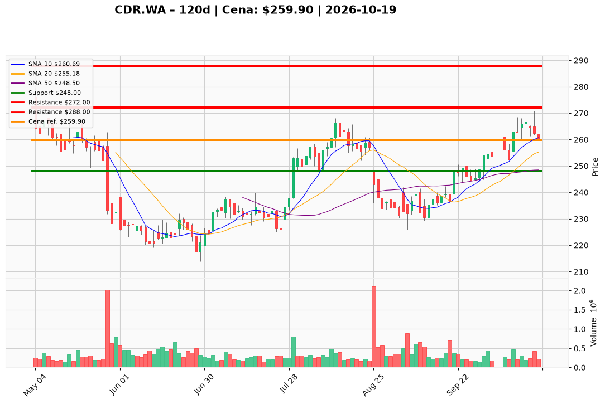

# CDR.WA — Ticket posiadacza (2026-10-19)

**Werdykt:** HOLD
**Horyzont:** swing (dni–tygodnie)
**Cena ref.:** 259.9 PLN

| | Poziom | Uwagi |
|---|--------|------|
| **Akcja teraz** | Trzymaj | Pozycja zapisana @ 271.0 PLN (−4,1% P/L vs ref.) |
| **Stop-loss** | 248.0 PLN | twardy — pod klastrem 50 SMA i bazą przed rajdem remasterowym |
| **TP1** | 272.0 PLN | redukcja ~30% przy zbliżeniu do zera z 271 |
| **TP2** | 288.0 PLN | wyjście z reszty — strefa oporu pod szczytami I 2026 |

**Sizing / skala:** Utrzymaj pełny lot CDR.WA. Bez dokupu bez zamknięcia dziennego > 265.0 PLN przy wolumenie > 250 tys. Ryzyko od ref.: ~11,9 PLN/akcję (259,9→248).

**Warunek dokupu** (jeśli ADD): Zamknięcie dzienne > 265.0 PLN przy wolumenie > 250 tys. — na razie nieaktywny (korekta po RSI >70, histogram MACD słabnie).

**Unieważnienie / pełne wyjście:** Zamknięcie dzienne poniżej 248.0 PLN na podwyższonym wolumenie — wyjście z całości.

**Dlaczego (1–2 zdania):** Średnioterminowy trend pozostaje wzrostowy (cena nad 50/200 SMA, dodatni MACD), a spadek z 266 do 259,9 PLN to techniczna konsolidacja bez negatywnego newsa o sprzedaży remastera; przy wejściu 271 PLN celem jest dotarcie do TP1/TP2 przy zachowaniu SL 248.

**WERDYKT KOŃCOWY:** HOLD — trzymaj lot @ 271.0 PLN, SL 248.0, TP1 272.0, TP2 288.0

