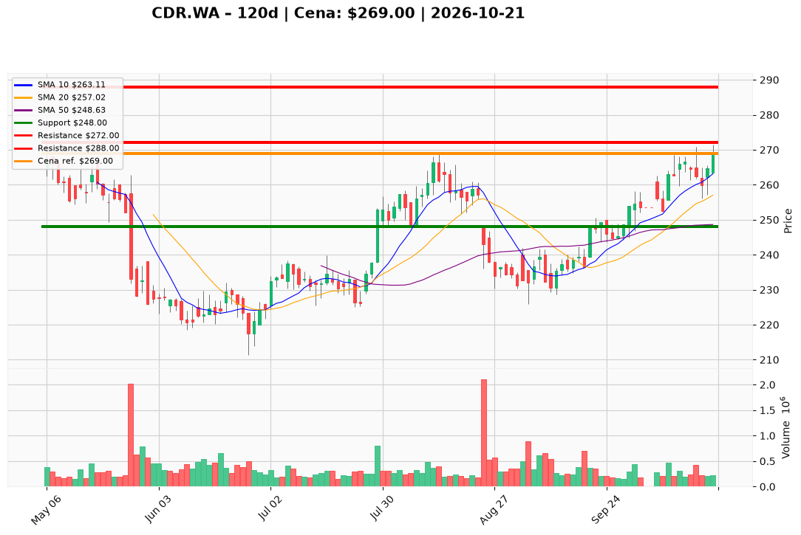

# CDR.WA — Ticket posiadacza (2026-10-21)

**Werdykt:** HOLD
**Horyzont:** swing (dni–tygodnie)
**Cena ref.:** 269.0 PLN

| | Poziom | Uwagi |
|---|--------|------|
| **Akcja teraz** | Trzymaj | Pozycja zapisana @ 271.0 PLN (−0,7% P/L vs ref.) |
| **Stop-loss** | 248.0 PLN | twardy — pod klastrem 50 SMA i bazą przed rajdem remasterowym |
| **TP1** | 272.0 PLN | redukcja ~30% przy dotknięciu (górna wstęga Bollingera ~272) |
| **TP2** | 288.0 PLN | wyjście z reszty — strefa oporu pod szczytami I 2026 |

**Sizing / skala:** Utrzymaj pełny lot CDR.WA. Bez dokupu — zamknięcie > 265.0 PLN jest spełnione, ale wolumen 21.10 (~218 tys.) < 250 tys. Ryzyko od ref. do SL: ~21 PLN/akcję.

**Warunek dokupu** (jeśli ADD): Zamknięcie dzienne > 265.0 PLN **i** wolumen > 250 tys. — na razie nieaktywny (brak potwierdzenia wolumenem).

**Unieważnienie / pełne wyjście:** Zamknięcie dzienne poniżej 248.0 PLN na podwyższonym wolumenie — wyjście z całości.

**Dlaczego (1–2 zdania):** Odbicie do 269 PLN po konsolidacji, trend średnioterminowy nad SMA 50/200 i dodatni MACD; news o sprzedaży remastera i Cyberpunku wspiera trzymanie lotu @ 271 PLN z planem częściowej realizacji na 272 i SL 248.

**WERDYKT KOŃCOWY:** HOLD — trzymaj lot @ 271.0 PLN, SL 248.0, TP1 272.0, TP2 288.0

