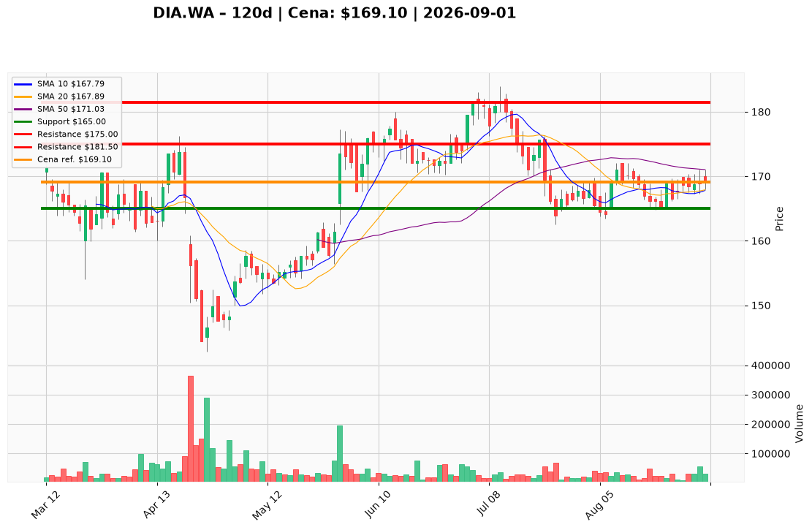

# DIA.WA — Ticket posiadacza (2026-09-01)

**Werdykt:** HOLD
**Horyzont:** pozycja (tygodnie–miesiące)
**Cena ref.:** 169,10 PLN
**Pozycja zapisana:** wejście 167,00 PLN (P/L nier. +1,3%)

| | Poziom | Uwagi |
|---|--------|------|
| **Akcja teraz** | Trzymaj | Nie dokupuj na spot; utrzymaj obecną ekspozycję |
| **Stop-loss** | 165,00 PLN | twardy — poniżej dołka sierpniowego i 1,5× ATR |
| **TP1** | 175,00 PLN | redukcja ~50% przy półce konsolidacji z lipca |
| **TP2** | 181,50 PLN | wyjście z reszty przy szczycie odbicia z lipca 2026 |

**Sizing / skala:** 0% nowego kapitału przy 169,10 PLN. Przy potwierdzonym wybiciu (dzienne zamknięcie >171,75 PLN, wolumen >50 000 szt.) ryzykuj 1,0–1,5% equity do SL 165 PLN (strefa wejścia 171,75–173,00 PLN). Opcjonalny starter na pullbacku: max 0,5% equity, połowa planowanej wielkości, strefa 165,00–166,00 PLN.

**Warunek dokupu** (jeśli ADD): dzienne zamknięcie powyżej 171,75 PLN z wolumenem >50 000 szt., lub opcjonalny półstarter na pullbacku do 165,00–166,00 PLN.

**Unieważnienie / pełne wyjście:** dzienne zamknięcie poniżej 164,00 PLN — pełne wyjście; otwiera ścieżkę w kierunku 159,00 i 150,00 PLN niezależnie od fundamentów.

**Dlaczego (1–2 zdania):** Fundamenty wspierają posiadanie (Q1 przychody +13% r/r, marża brutto ~79%, forward P/E ~17x, FCF yield ~4,7%), ale cena pozostaje poniżej SMA 50/200 po trzech odrzuceniach przy 171–172 PLN na cienkim wolumenie — cierpliwość do potwierdzenia technicznego.

**WERDYKT KOŃCOWY:** HOLD — trzymaj pozycję, nie dokupuj na bieżącej cenie; zarządzaj SL 165 PLN i celami 175 / 181,50 PLN.

