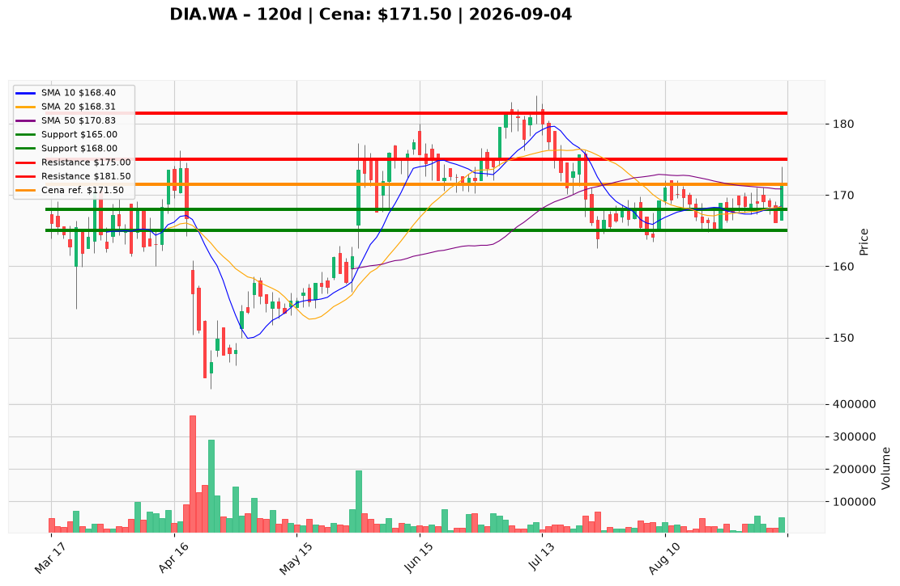

# DIA.WA — Ticket posiadacza (2026-09-04)

**Werdykt:** HOLD
**Horyzont:** Pozycja (tygodnie–miesiące)
**Cena ref.:** 171,50 PLN

**Pozycja zapisana:** wejście 167,00 PLN | P/L: **+2,7%** (+4,50 PLN/akcję)

| | Poziom | Uwagi |
|---|--------|------|
| **Akcja teraz** | Trzymaj | Bez dokupu przy 171,50 — cena przy górnej granicy zakresu 160–175 |
| **Stop-loss** | 165,00 PLN | Twardy — poniżej dołka sierpniowego; ~1,2% ryzyka od wejścia |
| **TP1** | 175,00 PLN | Redukcja 30–40% pozycji przy sukcesie testu oporu |
| **TP2** | 181,50 PLN | Wyjście z reszty — kolejny poziom strukturalny |

**Sizing / skala:** Utrzymaj obecną ekspozycję. Nie dokupuj powyżej 170 PLN. Dokup rozważ tylko po zamknięciu >173 PLN z potwierdzeniem wolumenem.

**Warunek dokupu** (jeśli ADD): Zamknięcie dzienne >173 PLN + wolumen >35 tys. szt.

**Unieważnienie / pełne wyjście:** Tygodniowe zamknięcie poniżej 165,00 PLN — pełny exit.

**Dlaczego (1–2 zdania):** Diagnostyka potwierdza jakość biznesu (Q1 2026: przychody 671M PLN, EBIT 123M, ROE 51%), a sesja 4.09 (odbicie z 166,50 → 171,50 na 2,5× wolumenie, MACD+) usuwa ryzyko NWZ. Jednak akcja jest przy oporze 175 z wysokim zadłużeniem (D/E 177) — dla posiadacza z wejściem 167 PLN optymalne jest trzymanie ze stop-loss 165 i realizacja częściowa przy 175.

**WERDYKT KOŃCOWY:** TRZYMAJ pozycję — SL 165, TP1 175 (redukcja 30–40%), TP2 181,50; bez dokupu przy obecnej cenie.

