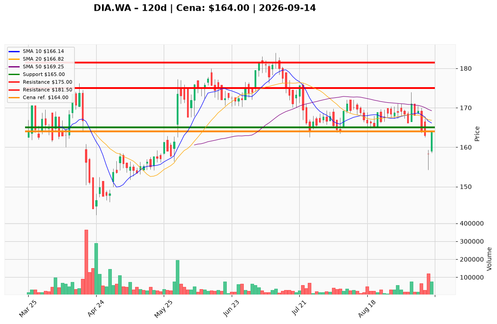

# DIA.WA — Ticket posiadacza (2026-09-14)

**Werdykt:** EXIT
**Horyzont:** pozycja (tygodnie–miesiące)
**Cena ref.:** 164,00 PLN

**Pozycja zapisana (DIA.WA):** wejście **167,00 PLN**; SL zapisany **165,00 PLN**; TP1 zapisany **175,00 PLN**; TP2 zapisany **181,50 PLN**.
P/L vs 164,00: **−3,00 PLN (−1,8%)**. Zapisany SL 165,00 jest już przebity.

| | Poziom | Uwagi |
|---|--------|------|
| **Akcja teraz** | Sprzedaj 100% @ market | PM Sell; nie dokupuj odbicia 164 |
| **Stop-loss** | **165,00 PLN** | twardy (pozycja zapisana) — już naruszony, wykonaj teraz |
| **TP1** | **175,00 PLN** | plan zapisany; nieaktualny przy EXIT |
| **TP2** | **181,50 PLN** | plan zapisany; nieaktualny przy EXIT |

**Sizing / skala:** Zero nowego kapitału. Nie odwracaj tego lota na short — mapa tradera 165,20 / 169,80 / 161,04 / 154,20 PLN jest dla nowego shorta, nie dla posiadacza.
**Warunek dokupu:** Brak — ADD zablokowany.
**Unieważnienie / pełne wyjście:** Teraz. Zapisany SL 165,00 przebity (close 164,00); PM: Sell.

**Dlaczego (1–2 zdania):** PM i Trader: Sell — miss konwersji (NI 57,4m, −10,1% r/r), bounce w downtrendzie pod 10 EMA / VWMA / 50 i 200 SMA po death-cross 11.09. Long z 167,00 ma SL 165 już z tyłu; nie uśredniaj.

**WERDYKT KOŃCOWY:** **EXIT** — sprzedaj 100% pozycji DIA.WA @ market (wejście 167,00; P/L −1,8%); poziomy zapisane SL **165,00** / TP1 **175,00** / TP2 **181,50** PLN (SL już przebity).

