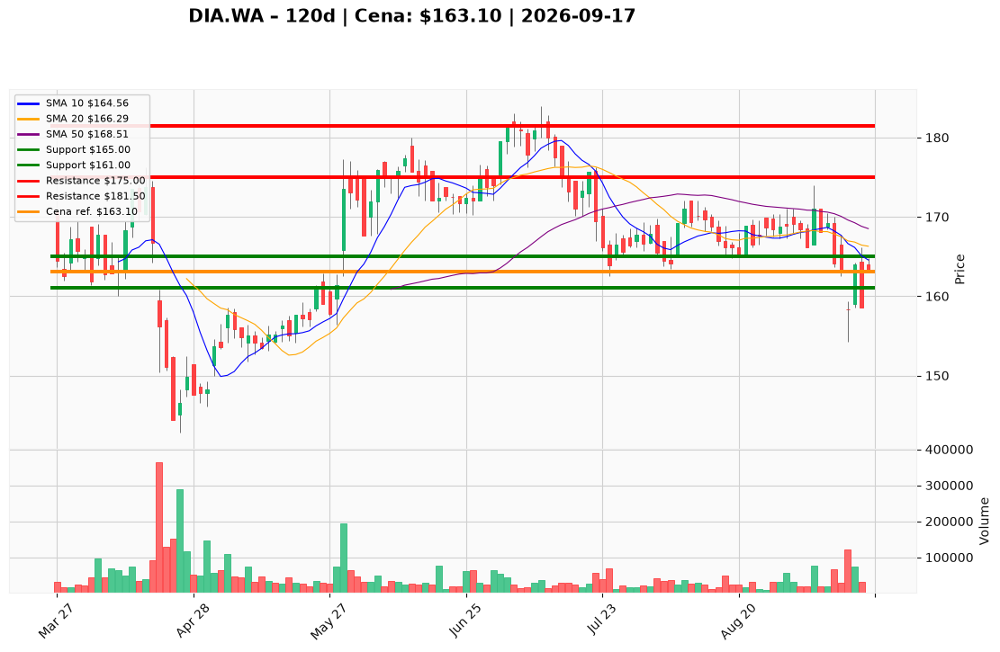

# DIA.WA — Ticket posiadacza (2026-09-17)

**Werdykt:** EXIT
**Horyzont:** pozycja (tygodnie–miesiące)
**Cena ref.:** 163,10 PLN

**Pozycja zapisana (DIA.WA):** wejście **167,00 PLN**; SL zapisany **165,00 PLN**; TP1 zapisany **175,00 PLN**; TP2 zapisany **181,50 PLN**.
P/L vs 163,10: **−3,90 PLN (−2,3%)**. Zapisany SL 165,00 jest już przebity (close 163,10).

| | Poziom | Uwagi |
|---|--------|------|
| **Akcja teraz** | Sprzedaj 100% @ market | PM Sell; nie dokupuj odbicia 163,10 |
| **Stop-loss** | **165,00 PLN** | twardy (pozycja zapisana) — już naruszony, wykonaj teraz |
| **TP1** | **161,00 PLN** | pierwszy cel spadkowy (PM); nieaktualny przy EXIT |
| **TP2** | **154,20 PLN** | dołek sesji 11.09 (PM); nieaktualny przy EXIT |

**Sizing / skala:** Zero nowego kapitału. Nie uśredniaj w downtrendzie — death cross 11.09, MACD −1,85, wolumen odbicia maleje (74,8k → 31,4k → 29,3k).
**Warunek dokupu:** Brak — ADD zablokowany. Warunek ponownego wejścia: close > 169,80 przy wolumenie ≥ 80k.
**Unieważnienie / pełne wyjście:** Teraz. SL 165,00 przebity; miss konwersji (NI 57,4 mln vs konsensus 63,6 mln), marża operacyjna 14,0% vs 18,1% TTM, gotówka 17,6 mln (minimum 5 kwartałów).

**Dlaczego (1–2 zdania):** PM i Trader: Sell — odbicie z 158,60 do 163,10 to dead-cat bounce pod 10 EMA / VWMA / 50 i 200 SMA po miss wyników. Long z 167,00 ma SL 165 już z tyłu; trzymanie łamie dyscyplinę ryzyka.

**WERDYKT KOŃCOWY:** **EXIT** — sprzedaj 100% pozycji DIA.WA @ market (wejście 167,00; P/L −2,3%); poziomy PM SL **165,00** / TP1 **161,00** / TP2 **154,20** PLN (SL już przebity).

