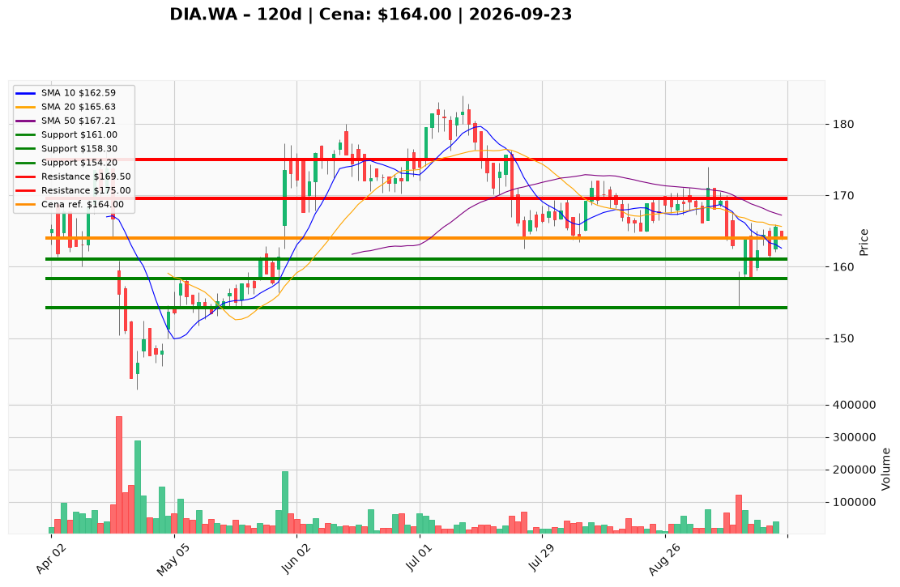

# DIA.WA — Ticket posiadacza (2026-09-23)

**Werdykt:** HOLD
**Horyzont:** pozycja (tygodnie–miesiące)
**Cena ref.:** 164,00 PLN

**Pozycja zapisana (DIA.WA):** wejście **167,00 PLN**; SL zapisany **165,00 PLN** (aktualizacja PM → **161,00 PLN**); TP1 zapisany **161,00 PLN** (aktualizacja PM → **169,50 PLN**); TP2 zapisany **154,20 PLN** (aktualizacja PM → **175,00 PLN**).
P/L vs 164,00: **−3,00 PLN (−1,8%)**. Cena powyżej SL 165 po odbiciu z dołka 154,20 (11.09), ale nadal poniżej 50 SMA (167,21) i 200 SMA (169,60).

| | Poziom | Uwagi |
|---|--------|------|
| **Akcja teraz** | Trzymaj 100% | PM Hold; nie dokupuj — brak wolumenu i reclaim MA |
| **Stop-loss** | **161,00 PLN** | twardy (PM) — poniżej dołków 18–20.09; naruszenie → EXIT |
| **TP1** | **169,50 PLN** | redukcja 30–40% przy powrocie do 200 SMA / breakeven |
| **TP2** | **175,00 PLN** | wyjście reszty przy oporze konsolidacji |

**Sizing / skala:** Zero nowego kapitału. Nie uśredniaj w downtrendzie bez close > 169,50 PLN przy wolumenie ≥ 60 tys.
**Warunek dokupu:** Brak — ADD zablokowany do czasu reclaim 50 SMA z potwierdzeniem wolumenem.
**Unieważnienie / pełne wyjście:** Close dzienny < 161,00 PLN — sprzedaj 100% @ market.

**Dlaczego (1–2 zdania):** Jakościowy biznes (ROE 55%, dywidenda 2,66%) po korekcie post-earnings; stabilizacja nad 10 EMA/VWMA i histogram MACD dodatni, ale miss wyników Q2, cienka gotówka (17,6 mln PLN) i słaby wolumen odbicia nie uzasadniają dokupu — trzymaj z dyscypliną SL 161.

**WERDYKT KOŃCOWY:** **HOLD** — utrzymaj pozycję DIA.WA (wejście 167,00; P/L −1,8%); SL **161,00** / TP1 **169,50** / TP2 **175,00** PLN; nie dokupuj.

