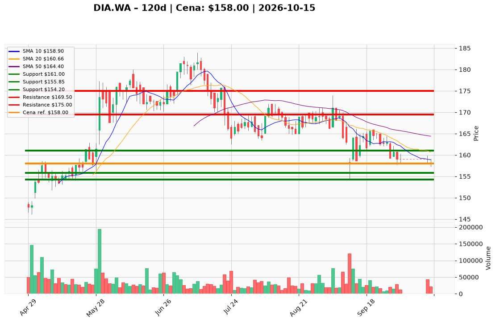

# DIA.WA — Ticket posiadacza (2026-10-15)

**Werdykt:** EXIT
**Horyzont:** pozycja (tygodnie–miesiące)
**Cena ref.:** 158,00 PLN

**Pozycja zapisana (DIA.WA):** wejście **167,00 PLN**; SL zapisany **161,00 PLN**; TP1 **169,50 PLN**; TP2 **175,00 PLN**.
P/L vs 158,00: **−9,00 PLN (−5,4%)**. Zamknięcia **≤159 PLN** w październiku **naruszyły** planowy stop **161,00 PLN**; kurs poniżej 10 EMA (159,19), 50 SMA (164,40) i 200 SMA (169,23).

| | Poziom | Uwagi |
|---|--------|------|
| **Akcja teraz** | Sprzedaj **100%** @ market | PM **Sell** — egzekucja wcześniejszego warunku wyjścia |
| **Stop-loss** | **161,00 PLN** | planowy — **już naruszony**; brak powodu do trzymania |
| **TP1** | **169,50 PLN** | tylko przy ewentualnym ponownym wejściu po naprawie trendu |
| **TP2** | **175,00 PLN** | opór konsolidacji / cel rozciągnięty |

**Sizing / skala:** Zamknij cały lot; **zero dokupów**. Kapitał zwolnij do momentu, gdy dzienne zamknięcie powyżej **164,40 PLN** (50 SMA) z wolumenem ≥ 50 tys.
**Warunek dokupu:** Brak — ADD zablokowany.
**Unieważnienie / pełne wyjście:** Już spełnione (close < 161,00 PLN). Jeśli nie sprzedano — **wyjdź natychmiast** @ market; awaryjny techniczny poziom **155,00 PLN** (poniżej pasma Bollingera / dołek 157,30 z 15.10).

**Dlaczego (1–2 zdania):** Jakościowy biznes (ROE ~55%, dywidenda 2,77%), ale miss Q2, cienka gotówka (17,6 mln PLN) i słaby sentyment nie rekompensują złamanego trendu — dyscyplina risk management ważniejsza niż nadzieja na odbicie od 154–155 PLN.

**WERDYKT KOŃCOWY:** **EXIT** — zamknij pozycję DIA.WA (wejście 167,00; strata ok. −5,4%); planowy SL **161,00** został naruszony; nie dokupuj.

