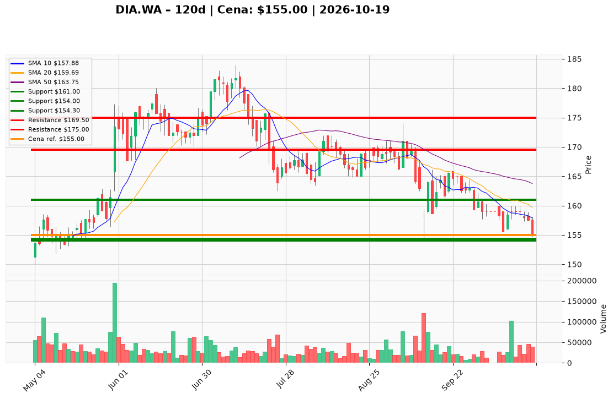

# DIA.WA — Ticket posiadacza (2026-10-19)

**Werdykt:** EXIT
**Horyzont:** pozycja (tygodnie–miesiące)
**Cena ref.:** 155,00 PLN

**Pozycja zapisana (DIA.WA):** wejście **167,00 PLN**; SL zapisany **161,00 PLN**; TP1 **169,50 PLN**; TP2 **175,00 PLN**.
P/L vs 155,00: **−12,00 PLN (−7,2%)**. Zamknięcie **155,00 PLN** utrzymuje naruszenie planowego stopu **161,00 PLN** i testuje poziom awaryjny **155,00 PLN**; kurs poniżej 10 EMA (157,97), 50 SMA (163,75) i 200 SMA (169,08). Dołek sesji **154,70 PLN** przy dolnej wstęgu Bollingera **154,34 PLN**.

| | Poziom | Uwagi |
|---|--------|------|
| **Akcja teraz** | Sprzedaj **100%** @ market | PM **Sell** — egzekucja planu ryzyka |
| **Stop-loss** | **161,00 PLN** | planowy — **naruszony**; jeśli jeszcze w pozycji: wyjście przy zamknięciu **<154,00 PLN** |
| **TP1** | **169,50 PLN** | tylko przy ewentualnym ponownym wejściu po naprawie trendu |
| **TP2** | **175,00 PLN** | opór konsolidacji / cel rozciągnięty |

**Sizing / skala:** Zamknij cały lot; **zero dokupów**. Kapitał zwolnij do momentu, gdy dzienne zamknięcie powyżej **163,75 PLN** (50 SMA) z wolumenem ≥ 50 tys.
**Warunek dokupu:** Brak — ADD zablokowany.
**Unieważnienie / pełne wyjście:** Spełnione (close < 161,00 PLN). Jeśli nie sprzedano — **wyjdź natychmiast** @ market; awaryjny techniczny poziom **154,00 PLN** (poniżej dołka wrz. **154,20 PLN**).

**Dlaczego (1–2 zdania):** Jakościowy biznes (ROE ~55%, dywidenda ~2,8%), ale miss Q2, ciasna płynność bilansowa i słaby sentyment nie rekompensują złamanego trendu — dyscyplina risk management ważniejsza niż nadzieja na odbicie od 154–155 PLN.

**WERDYKT KOŃCOWY:** **EXIT** — zamknij pozycję DIA.WA (wejście 167,00; strata ok. −7,2%); planowy SL **161,00** został naruszony; nie dokupuj.

