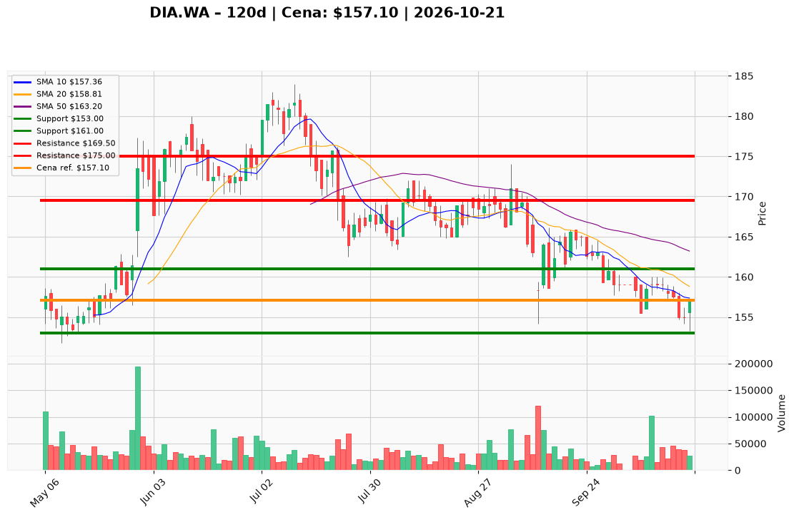

# DIA.WA — Ticket posiadacza (2026-10-21)

**Werdykt:** HOLD
**Horyzont:** pozycja (tygodnie–miesiące)
**Cena ref.:** 157,10 PLN

**Pozycja zapisana (DIA.WA):** wejście **167,00 PLN**; poprzedni SL **161,00 PLN** (naruszony); cele TP1 **169,50 PLN** / TP2 **175,00 PLN**.
P/L vs 157,10: **−9,90 PLN (−5,9%)**. Kurs odbił z dołka **155,00 PLN**, ale nadal poniżej 50 SMA (**163,20**) i 200 SMA (**168,90**); dołek sesji **153,30 PLN**.

| | Poziom | Uwagi |
|---|--------|------|
| **Akcja teraz** | Trzymaj 100% | bez dokupu @ market |
| **Stop-loss** | **153,00 PLN** | twardy — poniżej dołka 21.10 i dolnej wstęgi |
| **TP1** | **169,50 PLN** | redukcja ~50% pozycji |
| **TP2** | **175,00 PLN** | wyjście z reszty |

**Sizing / skala:** Pełny lot tylko przy akceptacji stopu **153** (~2,6% ryzyka od ceny ref.); brak dokupów do zamknięcia dziennego **>163,20 PLN** (50 SMA) z wolumenem ≥ 50 tys.
**Warunek dokupu:** Brak (ADD zablokowany).
**Unieważnienie / pełne wyjście:** Zamknięcie dzienne **<153,00 PLN** → wyjście @ market; awaryjnie obserwuj strefę **146,40 PLN** (min. 52 tyg.).

**Dlaczego (1–2 zdania):** Jakościowy biznes (ROE ~55%, dywidenda ~2,8%, cel analityków ~181 PLN), ale miss Q2 i słaby trend wymagają dyscypliny — utrzymujesz pozycję tylko z zaostrzonym SL, bez dokładania w spadającym trendzie.

**WERDYKT KOŃCOWY:** **HOLD** — trzymaj DIA.WA (wejście 167,00); SL **153,00**; TP1 **169,50** / TP2 **175,00**; nie dokupuj.

