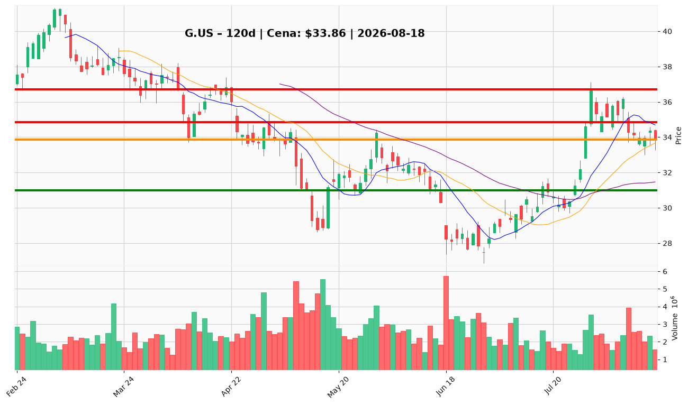

# G.US — Ticket posiadacza (2026-08-18)

**Werdykt:** REDUCE
**Horyzont:** swing (dni–tygodnie)
**Cena ref.:** $33.86 (zamknięcie 2026-08-14)

| | Poziom | Uwagi |
|---|--------|------|
| **Akcja teraz** | redukcja 25–30% w strefie $34.00–$34.50 | sprzedaj część na odbiciu w opór; resztę trzymaj z SL |
| **Stop-loss** | $31.00 | twardy; zamknięcie dzienne poniżej = pełne wyjście |
| **TP1** | $34.85 | pierwsza strefa realizacji (VWMA / 10 EMA); redukcja 25–50% przy odbiciu |
| **TP2** | $36.71 | druga redukcja przy szczycie lipcowym; reszta do wyjścia przy potwierdzeniu momentum |

**Sizing / skala:** po redukcji 25–30% utrzymaj 70–75% pozycji z twardym SL $31.00; bez pełnowymiarowych dokupów na obecnym poziomie.

**Warunek dokupu** (ADD): opcjonalny starter ~15% tylko dla kont z rezerwą gotówki; pełny dokup dopiero po dziennym zamknięciu > $35.00 przy wolumenie > 2,2M.

**Unieważnienie / pełne wyjście:** zamknięcie dzienne < $31.00 — teza odbicia lipcowa nieaktualna; kolejne cele $29.43 (dolne Bollinger), potem $28.25 (dołek czerwcowy).

**Dlaczego (1–2 zdania):** H1 2026 FCF praktycznie płaski przy wzroście należności o $162M vs ~2% przychodów — główne ryzyko fundamentalne przed Q3; technicznie trend niedźwiedzi (~10% poniżej 200 SMA), MACD ujemny i dwukrotna porażka przy $36.71. Sektor wspiera (+20,5% w 6M), lecz insider selling przy ~$34 i nierozstrzygnięta konwersja gotówki uzasadniają underweight i częściową realizację w opór.

**WERDYKT KOŃCOWY:** REDUCE — sprzedaj 25–30% w strefie $34.00–$34.50, resztę trzymaj z SL $31.00, TP1 $34.85, TP2 $36.71; bez pełnych dokupów do breakoutu > $35.00 lub poprawy FCF w Q3.

