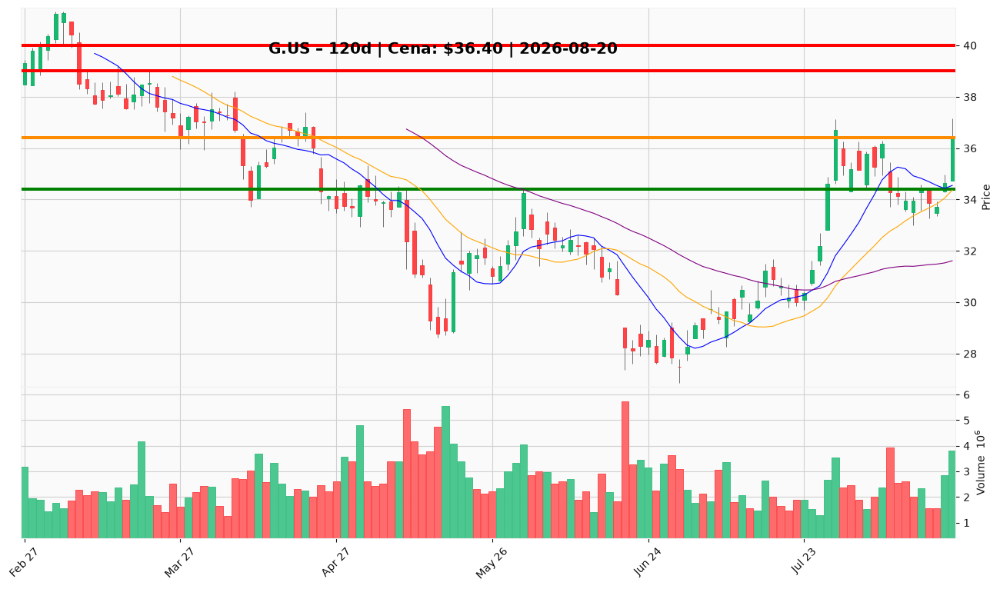

# G.US — Ticket posiadacza (2026-08-20)

**Werdykt:** REDUCE
**Horyzont:** swing (dni–tygodnie)
**Cena ref.:** $36.40

**Pozycja zapisana:** wejście $33.97 | poprzedni SL $31.00 | TP1 $34.85 | TP2 $36.71 (TP2 osiągnięty)

| | Poziom | Uwagi |
|---|--------|------|
| **Akcja teraz** | redukcja 25–40% w strefie $37.15–$37.61 | sprzedaj część w opór 200 SMA / górne Bollinger; resztę trzymaj z podniesionym SL |
| **Stop-loss** | $34.39 | twardy (1,5× ATR); zamknięcie dzienne < $34.27 = pełne wyjście |
| **TP1** | $39.00 | redukcja części po potwierdzonym breakoutu 200 SMA |
| **TP2** | $40.00 | wyjście z reszty — cel bazowy fundamentalny |

**Sizing / skala:** po redukcji 25–40% utrzymaj 60–75% pozycji z SL $34.39; 0% nowej alokacji na obecnym poziomie; bez dokupów do pullbacku $34.60–$35.00 lub breakoutu > $37.61 (wolumen > 2,5M).

**Warunek dokupu** (ADD): tylko po pullbacku do $34.60–$35.00 (~1,5–2% ryzyka) lub dziennym zamknięciu > $37.61 przy wolumenie > 2,5M (~1% ryzyka).

**Unieważnienie / pełne wyjście:** zamknięcie dzienne < $34.27 (dołek 18.08) lub brak reclaim $37.61 w horyzont swing — rally odwraca się w kierunku 50 SMA ($31.61).

**Dlaczego (1–2 zdania):** Fundamenty atrakcyjne (~8× forward P/E, 22% ROE), ale po 13% wzrostu w miesiącu setup przy $36.40 jest niekorzystny: odrzucenie przy 200 SMA ($37.61), ujemny MACD, dywergencja RSI i pogorszona konwersja gotówki (należności +$146M QoQ). PM Underweight — realizuj część w opór, podnieś SL.

**WERDYKT KOŃCOWY:** REDUCE — sprzedaj 25–40% w strefie $37.15–$37.61, resztę trzymaj z SL $34.39, TP1 $39.00, TP2 $40.00; bez dokupów do pullbacku $34.60–$35.00 lub breakoutu > $37.61.

