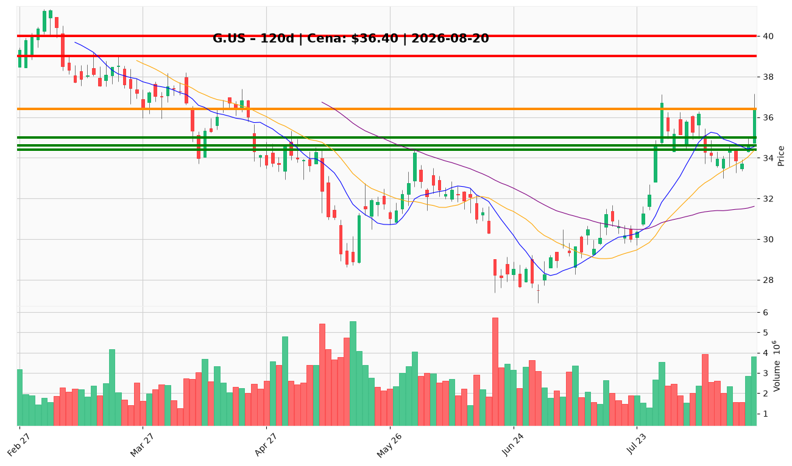

# G.US — Ticket (2026-08-20)

**Werdykt:** WAIT
**Horyzont:** swing (dni–tygodnie)
**Cena ref.:** $36.40

| | Poziom | Uwagi |
|---|--------|------|
| **Wejście** | $34.60–$35.00 (limit) lub > $37.61 | pullback do klastra wsparcia albo dzienne zamknięcie powyżej 200 SMA przy wolumenie > 2,5M |
| **Stop-loss** | $34.39 | twardy (1,5× ATR); zamknięcie dzienne < $34.27 = pełne unieważnienie |
| **TP1** | $39.00 | zrealizuj ~50% po potwierdzonym breakoutu 200 SMA |
| **TP2** | $40.00 | reszta — cel bazowy fundamentalny |

**Sizing:** 0% kapitału przy bieżącej cenie; po aktywacji pullback ~1,5–2% ryzyka (R ≈ 1:2,2) lub po breakout ~1% ryzyka (R ≈ 1:1,5)

**Warunek aktywacji:** (1) limit buy w strefie $34.60–$35.00, albo (2) dzienne zamknięcie > $37.61 przy wolumenie > 2,5M — nie gonij po wyjściu z $37.00 w ten sam opór 200 SMA

**Unieważnienie:** zamknięcie dzienne < $34.27 (dołek 18.08) lub brak reclaim $37.61 w horyzont swing — rally odwraca się w kierunku 50 SMA ($31.61)

**Dlaczego (1–2 zdania):** PM Underweight i Trader Hold — fundamenty atrakcyjne (~8× forward P/E, 22% ROE), ale po 13% wzroście w miesiącu setup przy $36.40 jest niekorzystny: odrzucenie przy 200 SMA ($37.61), ujemny MACD, dywergencja RSI i pogorszona konwersja gotówki. R/R przy ~$37 po świeżym wyjściu jest słaby — czekaj na pullback lub potwierdzony breakout.

**WERDYKT KOŃCOWY:** WAIT — nie inicjuj longa na bieżącym poziomie; aktywuj wejście dopiero po pullbacku $34.60–$35.00 (SL $34.39, TP1 $39.00, TP2 $40.00) lub breakout > $37.61 na wolumenie > 2,5M.

