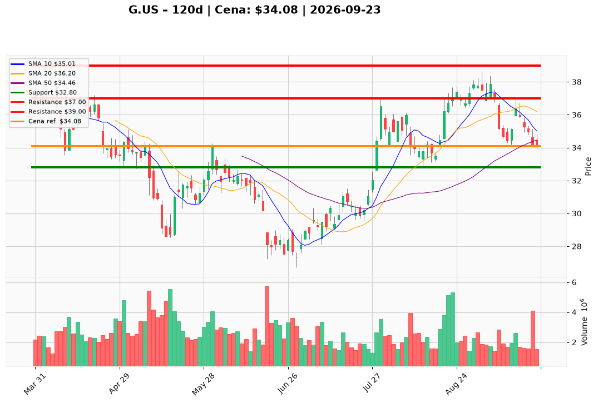

# G.US — Ticket posiadacza (2026-09-23)

**Werdykt:** HOLD
**Horyzont:** swing (dni–tygodnie)
**Cena ref.:** $34.08

**Pozycja zapisana:** wejście $37.16 | P/L: **-8,3%** | poprzedni SL $34.39 (przekroczony — aktualizacja poniżej)

| | Poziom | Uwagi |
|---|--------|------|
| **Akcja teraz** | Trzymaj | Bez dokupu — momentum krótkoterminowe słabe |
| **Stop-loss** | $32.80 | Twardy — poniżej dołka z 21.09 ($33.91) |
| **TP1** | $37.00 | Redukcja 50% przy powrocie do ceny wejścia |
| **TP2** | $39.00 | Wyjście z reszty — strefa oporu / 50 SMA |

**Sizing / skala:** Utrzymaj obecną ekspozycję. Nie dokupuj do czasu odzyskania $36.20 (środek Bollingera) na wolumenie.

**Unieważnienie / pełne wyjście:** Zamknięcie dzienne poniżej $32.80 — wyjdź w całości, teza o odbiciu od wsparcia unieważniona.

**Dlaczego (1–2 zdania):** Genpact jest tanio wyceniony (P/E 10x, dywidenda 2,2%), ale krótkoterminowy trend jest spadkowy (poniżej SMA 50/200, MACD ujemny). Przy wsparciu $33,50–$34,00 warto trzymać z zaostrzonym SL, ale nie dokupywać — CEO sprzedał akcje po $36,79.

**WERDYKT KOŃCOWY:** HOLD — trzymaj pozycję z SL $32.80, celuj w TP1 $37.00 / TP2 $39.00; wyjdź przy przełamaniu $32.80.

