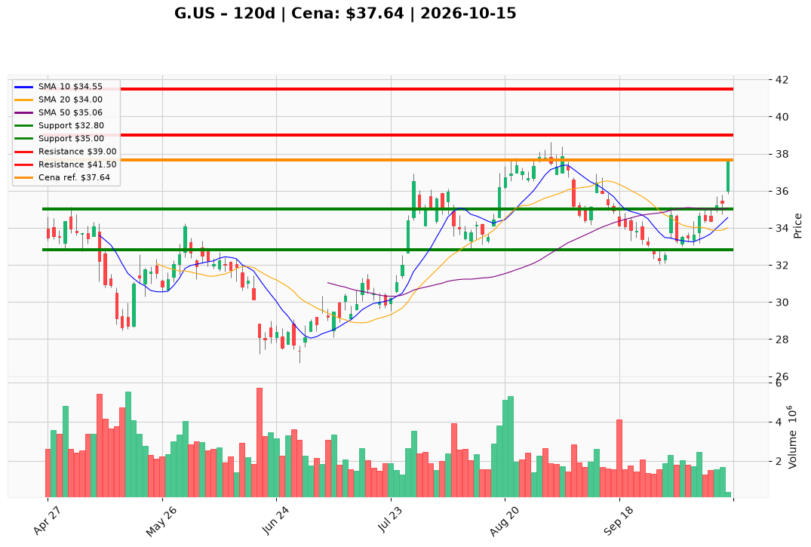

# G.US — Ticket posiadacza (2026-10-15)

**Werdykt:** HOLD
**Horyzont:** swing (dni–tygodnie)
**Cena ref.:** $37.64

**Pozycja zapisana:** wejście $37.16 | P/L: **+1,3%** | SL $32.80 | TP1 $39.00 | TP2 $41.50 (zaktualizowane vs poprzedni plan)

| | Poziom | Uwagi |
|---|--------|------|
| **Akcja teraz** | Trzymaj | Bez dokupu przy cenie nad górną wstęgą Bollingera |
| **Stop-loss** | $32.80 | Twardy — poniżej dołka wrześniowego / struktury swing |
| **TP1** | $39.00 | Redukcja ~50% — strefa oporu / psychologia |
| **TP2** | $41.50 | Wyjście z reszty — kolejna półka konsolidacji |

**Sizing / skala:** Utrzymaj obecną ekspozycję. Opcjonalnie redukcja 25% w strefie $38.00–$38.50 (ryzyko krótkoterminowego cofnięcia). Dokup tylko po pullbacku do $35.50–$36.00 z utrzymaniem MACD.

**Warunek dokupu** (jeśli ADD): Zamknięcie dzienne powyżej $36.20 po korekcie + wolumen ≥ średnia 20 sesji — **nie stosować teraz** (werdykt HOLD).

**Unieważnienie / pełne wyjście:** Zamknięcie dzienne poniżej $32.80 — wyjdź w całości. Ostrzejszy sygnał ostrzegawczy: zamknięcie poniżej $35.00 (powrót w zakres wrześniowy).

**Dlaczego (1–2 zdania):** Genpact odbił się z dołków ~$32 z potwierdzeniem wolumenu i krzyżówką MACD; wycena (forward P/E ~8×, FCF, dywidenda ~2,1%) uzasadnia trzymanie przy wejściu $37.16. Po wybiciu nad górną wstęgę Bollingera nie dokupuj — czekaj na realizację TP1 $39 / TP2 $41.50.

**WERDYKT KOŃCOWY:** HOLD — trzymaj z SL $32.80; realizuj częściowo przy $39.00 i $41.50; bez dokupu na $37.64.

