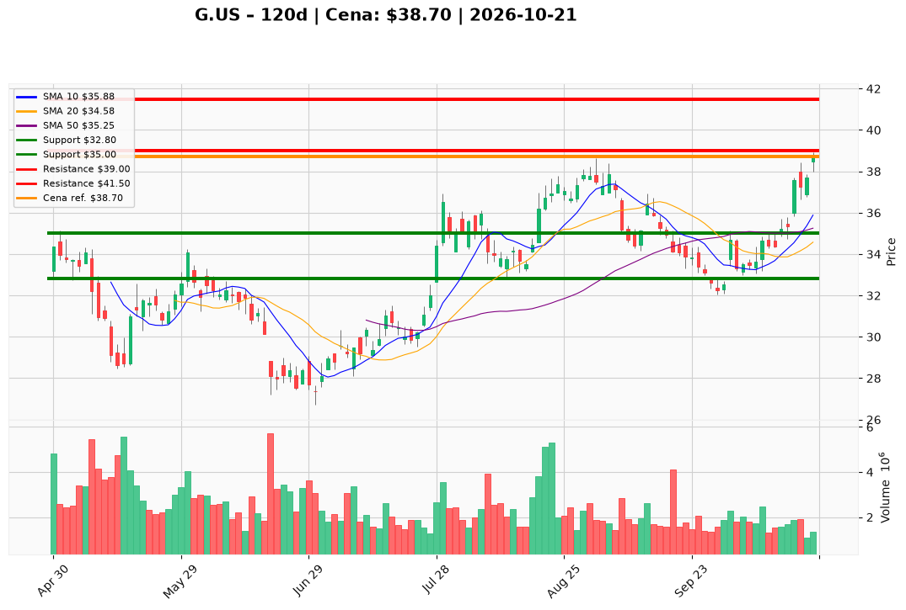

# G.US — Ticket posiadacza (2026-10-21)

**Werdykt:** HOLD
**Horyzont:** swing (dni–tygodnie)
**Cena ref.:** $38.70

**Pozycja zapisana:** wejście $37.16 | P/L: **+4,1%** | SL $32.80 | TP1 $39.00 | TP2 $41.50

| | Poziom | Uwagi |
|---|--------|------|
| **Akcja teraz** | Trzymaj | Bez dokupu — RSI ~71, cena nad górną wstęgą Bollingera |
| **Stop-loss** | $32.80 | Twardy — poniżej dołka wrześniowo-październikowego |
| **TP1** | $39.00 | Redukcja ~50% — pierwszy opór / realizacja zysku |
| **TP2** | $41.50 | Wyjście z reszty — kolejna półka w trendzie odbicia |

**Sizing / skala:** Utrzymaj obecną ekspozycję. Opcjonalna redukcja 25% w strefie $38.50–$39.00 (blisko TP1, RSI wykupiony). Dokup tylko po pullbacku do $35.50–$36.50 z utrzymaniem dodatniego MACD — **nie teraz**.

**Warunek dokupu** (jeśli ADD): Zamknięcie dzienne powyżej $36.50 po korekcie + wolumen ≥ średnia 20 sesji — **nie stosować** przy werdykcie HOLD na $38.70.

**Unieważnienie / pełne wyjście:** Zamknięcie dzienne poniżej $32.80 — wyjdź w całości. Sygnał ostrzegawczy: zamknięcie poniżej $35.00 (utrata październikowej strefy wzrostu).

**Dlaczego (1–2 zdania):** Odbicie z ~$32 utrzymało się — MACD rośnie, cena ponad SMA 50/200, a wycena (forward P/E ~8,6×, FCF, dywidenda ~2%) wspiera trzymanie lotu z wejścia $37.16. Przy RSI >70 i cenie $38.70 nie dokupuj; realizuj plan przy TP1 $39 / TP2 $41.50.

**WERDYKT KOŃCOWY:** HOLD — trzymaj z SL $32.80; realizuj częściowo przy $39.00 i $41.50; bez dokupu na $38.70.

