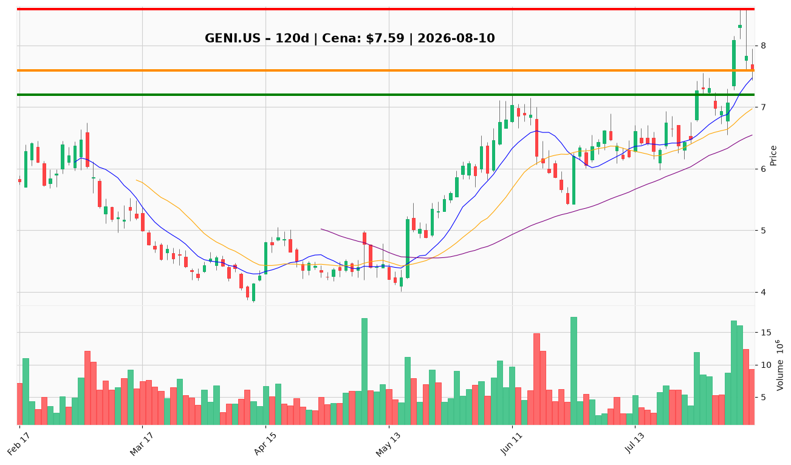

# GENI.US — Ticket posiadacza (2026-08-10)

**Werdykt:** HOLD
**Horyzont:** swing (dni–tygodnie)
**Cena ref.:** $7.59

| | Poziom | Uwagi |
|---|--------|------|
| **Akcja teraz** | Trzymaj | Utrzymaj pełną pozycję; brak dokupu przy obecnej cenie |
| **Stop-loss** | $7.20 | Twardy — poniżej 200 SMA i dołka z 07.08 |
| **TP1** | $8.59 | Redukcja 50% — szczyt intraday po wynikach Q2 |
| **TP2** | $9.00 | Wyjście z reszty — opór psychologiczny |

**Pozycja zapisana:** wejście $8.28 | SL $7.20 | TP1 $8.59 | TP2 $9.00

**Sizing / skala:** Utrzymaj obecną wielkość pozycji. Nie dokupuj — pozycja pod wodą (−8,3% od wejścia), a dźwignia D/E 120% po przejęciu Legend ogranicza apetyt na uśrednianie.

**Unieważnienie / pełne wyjście:** Zamknięcie dzienne poniżej $7.20 przy podwyższonym wolumenie → sprzedaj całość.

**Dlaczego (1–2 zdania):** Genius Sports raportuje przyspieszenie wzrostu (przychody Q2 +65%, adj. EBITDA +54%, podniesiona prognoza FY) i nowe umowy z Kalshi/Polymarket, ale odpływ po wynikach (−9% z $8.59) i wysoka dźwignia uzasadniają cierpliwość zamiast dokupu. Struktura techniczna nadal intact powyżej 50/200 SMA — istniejący SL $7.20 i cele $8.59/$9.00 pozostają aktualne.

**WERDYKT KOŃCOWY:** HOLD — trzymaj pozycję ze stop-loss $7.20, realizuj częściowo przy $8.59, zamknij resztę przy $9.00.

