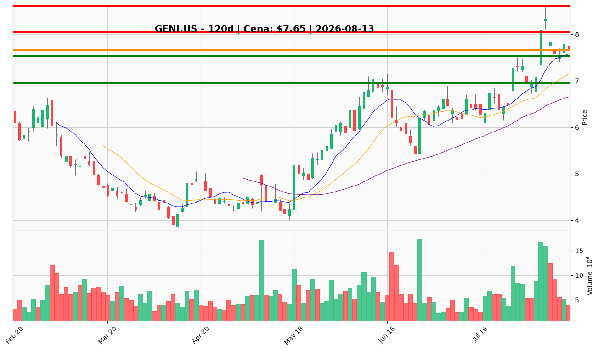

# GENI.US — Ticket posiadacza (2026-08-13)

**Werdykt:** HOLD
**Horyzont:** swing (dni–tygodnie)
**Cena ref.:** $7.65 (zamknięcie 2026-08-12)

**Pozycja zapisana:** entry $8.28, stop-loss $6.95, TP1 $8.05, TP2 $8.60 (z pamięci portfela).

| | Poziom | Uwagi |
|---|--------|------|
| **Akcja teraz** | trzymaj | bez dokupu — brak potwierdzenia powrotu ponad $7.90; sprzedaż dopiero przy TP/SL |
| **Stop-loss** | $6.95 | twardy; zamknięcie dzienne poniżej = pełne wyjście (wsparcie $7.53 / 50 SMA $6.65) |
| **TP1** | $8.05 | redukcja części przy półce oporu $8.04–8.08 |
| **TP2** | $8.60 | wyjście reszty przy szczycie z 2026-08-05 ($8.33) |

**Sizing / skala:** utrzymaj obecną wielkość; ewentualny dokup maks. 25% pozycji tylko po zamknięciu dziennym powyżej $7.90 (na potwierdzonym trendzie), z tym samym SL $6.95.

**Warunek dokupu** (ADD): dzienne zamknięcie > $7.90 przy rosnącym wolumenie — wtedy powrót do zarządzania wg powyższych TP.

**Unieważnienie / pełne wyjście:** zamknięcie dzienne < $6.95 — teza o odbiciu po Q2 przestaje obowiązywać; poniżej $6.65 (50 SMA) trend strukturalnie zepsuty.

**Dlaczego (1–2 zdania):** Q2: przychody +65% r/r ($196M), EBITDA $53M powyżej guidance, podniesiona prognoza na 2026, nowe umowy z Kalshi/Polymarket — fundamenty wspierają trzymanie; cena utrzymuje się powyżej 50 SMA ($6.65) i 200 SMA ($7.29), lecz histogram MACD słabnie (0.13 → 0.025) i brak holdu powyżej $8.33 każe czekać na potwierdzenie przed dokupem.

**WERDYKT KOŃCOWY:** HOLD — trzymaj z SL $6.95, TP1 $8.05, TP2 $8.60; bez dokupu do czasu zamknięcia dziennego > $7.90.

