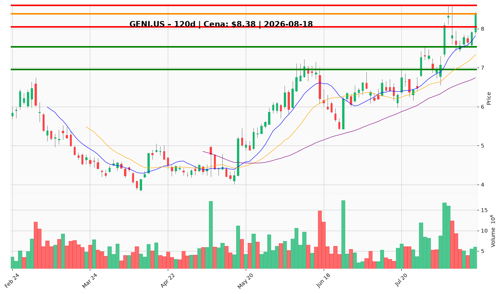

# GENI.US — Ticket posiadacza (2026-08-18)

**Werdykt:** HOLD
**Horyzont:** swing (dni–tygodnie)
**Cena ref.:** $8.38 (zamknięcie 2026-08-14)

**Pozycja zapisana:** entry $8.28, stop-loss $6.95, TP1 $8.05, TP2 $8.60 (z pamięci portfela).

| | Poziom | Uwagi |
|---|--------|------|
| **Akcja teraz** | trzymaj (rozważ redukcję 25% przy $8.38–8.43) | TP1 osiągnięty — zabezpiecz część zysku, resztę do TP2 |
| **Stop-loss** | $6.95 | twardy; zamknięcie dzienne poniżej = pełne wyjście (wsparcie taktyczne $7.53) |
| **TP1** | $8.05 | osiągnięty — redukcja 25% na sile w strefie $8.38–8.43 |
| **TP2** | $8.60 | wyjście reszty przy górnym paśmie Bollingera / szczycie z 2026-08-05 |

**Sizing / skala:** utrzymaj 75% pozycji po ewentualnej redukcji 25% na TP1; bez dokupu powyżej $8.40.

**Warunek dokupu** (ADD): dzienne zamknięcie > $8.43 przy wolumenie > 8M — dopiero wtedy potwierdzenie przebicia oporu.

**Unieważnienie / pełne wyjście:** zamknięcie dzienne < $6.95 — teza odbicia po Q2 przestaje obowiązywać; poniżej $7.53 (dołek z 2026-08-12) momentum swingowe złamane.

**Dlaczego (1–2 zdania):** Q2: przychody +65% r/r ($196M), znormalizowana EBITDA dodatnia, podniesiona prognoza — fundamenty uzasadniają trzymanie; cena powyżej wszystkich średnich (50 SMA $6.74, 200 SMA $7.25) i powyżej TP1, lecz histogram MACD słabnie (0.13 → 0.05) i opór $8.43–8.59 odrzucał już raz — rozsądna jest częściowa realizacja zysku z TP1 przy utrzymaniu reszty do TP2.

**WERDYKT KOŃCOWY:** HOLD — trzymaj z SL $6.95, TP1 $8.05 (osiągnięty — rozważ 25% redukcję), TP2 $8.60; bez dokupu powyżej $8.40 do czasu zamknięcia > $8.43.

