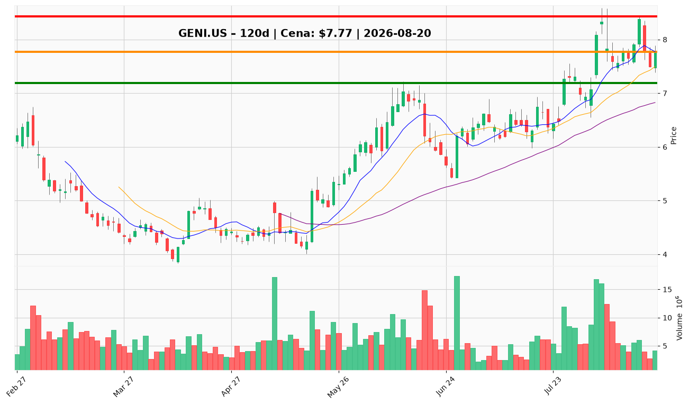

# GENI.US — Ticket posiadacza (2026-08-20)

**Werdykt:** HOLD
**Horyzont:** swing (dni–tygodnie)
**Cena ref.:** $7.77

**Pozycja zapisana:** entry $8.28, stop-loss $6.95, TP1 $8.05, TP2 $8.60 (z portfela).

| | Poziom | Uwagi |
|---|--------|------|
| **Akcja teraz** | trzymaj | bez dokupu powyżej $7.80 — cena pod entry, momentum słabnie (MACD −0.031) |
| **Stop-loss** | $7.19 | twardy (PM); zamknięcie dzienne < $7.20 = unieważnienie tezy odbicia |
| **TP1** | $8.43 | redukcja 25–30% przy oporze (szczyty z 5–14 VIII) |
| **TP2** | $9.25 | wyjście reszty w strefie $9.00–$9.50 po przebiciu |

**Sizing / skala:** utrzymaj obecną ekspozycję (cap 5–6% kapitału wg PM); bez zwiększania pozycji do czasu potwierdzenia.

**Warunek dokupu** (ADD): druga transza tylko przy (a) zamknięciu > $8.43 przy wolumenie > 10M, lub (b) utrzymaniu wsparcia $7.50–$7.65 (limit ~$7.65).

**Unieważnienie / pełne wyjście:** zamknięcie dzienne < $7.20 (200 SMA) z MACD poniżej zera — pełne wyjście; struktura odbicia złamana.

**Dlaczego (1–2 zdania):** Q2 2026 potwierdza infleksję (przychody +65% r/r, marża 32.6%, EBITDA dodatnia, P/E fwd ~7.3x), a cena trzyma się powyżej 50 i 200 SMA mimo pullbacku 18 VIII na niskim wolumenie — fundamenty uzasadniają cierpliwość, lecz nie gonienie w strefę oporu $8.33–$8.43.

**WERDYKT KOŃCOWY:** HOLD — trzymaj z SL $7.19, TP1 $8.43 (redukcja części), TP2 $9.25; dokup wyłącznie przy $7.50–$7.65 lub przebiciu > $8.43.

